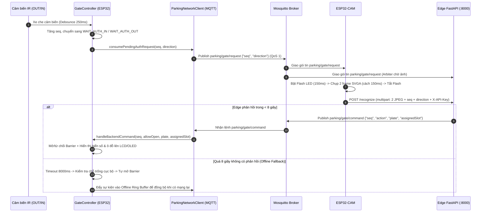

# Kế Hoạch Triển Khai Chi Tiết — Phase S2: Firmware ESP32 Chính (MQTT + Reserved Mask + WAIT_AUTH 8s) & Firmware ESP32-CAM

> **Mục tiêu Phase S2:** Nâng cấp toàn diện tầng Firmware trong Repo 1 (`iot-parking-station`) cho cả 2 vi điều khiển:
> 1. **ESP32 chính (`[env:nodemcu-32s]`)**: Bổ sung `reservedState[4]` vào `ParkingMonitor`, nâng cấp FSM `GateController` với trạng thái chờ xác thực biển số (`WAIT_AUTH_IN` / `WAIT_AUTH_OUT` + Offline Fallback 8s), nâng cấp hiển thị LCD 1602 & OLED 1.3" SH1106 theo sự kiện cổng + điều hướng ô đỗ, và chuyển `ParkingNetworkClient` sang giao thức **MQTT双向 (PubSubClient)** kèm LWT & Offline Event Queue.
> 2. **ESP32-CAM (`[env:esp32cam]`)**: Hoàn thiện firmware khởi tạo OV2640 (SVGA JPEG), kết nối MQTT lắng nghe `parking/gate/request`, nháy Flash LED, chụp burst 2 ảnh và đẩy `multipart/form-data` lên Edge Server (`POST /recognize`) kèm header `X-API-Key`.

---

## 1. Kiến Trúc Luồng Tương Tác Trong Phase S2

---

## 2. Danh Sách Các Bước Triển Khai (5 Steps)

### Step S2.1 — Nâng cấp `ParkingMonitor`: Quản lý `reservedState` & Ô đỗ khả dụng thực tế
* **File tác động:**
  * [`include/ParkingMonitor.h`](file:///f:/CodePJ/IOT-Parking/include/ParkingMonitor.h)
  * [`src/gate/ParkingMonitor.cpp`](file:///f:/CodePJ/IOT-Parking/src/gate/ParkingMonitor.cpp)
* **Chi tiết thay đổi:**
  1. Thêm mảng `bool reservedState[NUM_SLOTS];` vào `ParkingMonitor` (khởi tạo `false` trong `begin()`).
  2. Thêm các phương thức quản lý đặt chỗ từ MQTT (`parking/slots/reserved`):
     * `bool setReservedMask(bool a1, bool a2, bool b1, bool b2)`: Cập nhật `reservedState[0..3]`. Trả về `true` nếu có ít nhất 1 ô thay đổi trạng thái đặt trước (để kích hoạt cập nhật màn hình và gửi telemetry).
     * `bool isReserved(uint8_t slotIndex) const`: Trả về `true` nếu ô đang được đặt trước trên Cloud.
     * `bool isSlotAvailable(uint8_t slotIndex) const`: Trả về `!confirmedState[slotIndex] && !reservedState[slotIndex]`.
     * `uint8_t getReservedCount() const`: Đếm tổng số ô đang được đặt trước (mà chưa có xe đỗ vật lý).
  3. Cập nhật công thức tính chỗ trống công khai:
     * `getAvailableA()`: Đếm số ô thuộc Khu A (`0`, `1`) thỏa `isSlotAvailable(i)`.
     * `getAvailableB()`: Đếm số ô thuộc Khu B (`2`, `3`) thỏa `isSlotAvailable(i)`.
     * `getTotalAvailable()`: `getAvailableA() + getAvailableB()`.
     * `isFull()`: `getTotalAvailable() == 0`.
  4. Cập nhật `printStatus()` để in rõ 3 trạng thái của từng ô: `[X] CO XE`, `[R] DA DAT`, `[ ] TRONG`.

---

### Step S2.2 — Nâng cấp FSM `GateController`: Trạng thái `WAIT_AUTH` + Timeout 8s + Nhận lệnh MQTT
* **File tác động:**
  * [`include/GateController.h`](file:///f:/CodePJ/IOT-Parking/include/GateController.h)
  * [`src/gate/GateController.cpp`](file:///f:/CodePJ/IOT-Parking/src/gate/GateController.cpp)
* **Chi tiết thay đổi:**
  1. Mở rộng `enum GateEvent`:
     * Thêm `GATE_EVENT_WAITING_AUTH` (đang chờ camera & Edge AI xác thực biển số).
  2. Mở rộng `enum GateState`:
     * Thêm `GATE_STATE_WAIT_AUTH_IN` (xe ở cảm biến OUT, đang chờ lệnh mở cổng vào).
     * Thêm `GATE_STATE_WAIT_AUTH_OUT` (xe ở cảm biến IN, đang chờ lệnh mở cổng ra).
  3. Thêm cấu trúc dữ liệu cho lệnh chờ & Offline Fallback Event:
     * `uint32_t currentSeq`: Bộ đếm sequence tăng dần mỗi lần có xe kích hoạt cảm biến cổng.
     * `bool pendingAuthPublish`, `bool pendingAuthEntering`: Cờ báo cho `ParkingNetworkClient` biết cần publish `parking/gate/request` ngay lập tức.
     * `unsigned long authWaitTimestamp`: Mốc `millis()` bắt đầu chờ xác thực (`GATE_AUTH_TIMEOUT_MS = 8000`).
     * `char activePlate[16]`: Biển số xe vừa được Edge Server trả về (hoặc `"OFFLINE"` / `"LOCAL"`).
     * `char assignedSlot[8]`: Ô đỗ được gợi ý từ Edge Server (VD: `"A1"`, `"B2"`, hoặc `""`).
     * `bool pendingOfflineFallbackLog`, `uint32_t fallbackSeq`, `bool fallbackEntering`: Cờ ghi nhận cổng vừa tự mở theo cơ chế Offline Fallback 8s để `ParkingNetworkClient` lưu vào hàng đợi đồng bộ bù.
  4. Logic chuyển trạng thái trong `update(bool parkingFull, bool mqttConnected)`:
     * Tại `GATE_STATE_IDLE`:
       * Khi `confirmedSensorOut == true` (xe xin vào):
         * Nếu `!ENABLE_WIFI`: Kiểm tra `parkingFull` cục bộ như cũ (nếu đầy -> `BLOCKED_FULL`, nếu còn chỗ -> mở barrier ngay, `activePlate = "LOCAL"`).
         * Nếu `ENABLE_WIFI == true`: Tăng `currentSeq`, đặt `pendingAuthPublish = true`, `pendingAuthEntering = true`, `authWaitTimestamp = now`, `lastEvent = GATE_EVENT_WAITING_AUTH`, chuyển sang `GATE_STATE_WAIT_AUTH_IN`.
       * Khi `confirmedSensorIn == true` (xe xin ra):
         * Nếu `!ENABLE_WIFI`: Mở barrier ngay, chuyển sang `GATE_STATE_EXITING_WAIT_OUT`.
         * Nếu `ENABLE_WIFI == true`: Tăng `currentSeq`, đặt `pendingAuthPublish = true`, `pendingAuthEntering = false`, `authWaitTimestamp = now`, `lastEvent = GATE_EVENT_WAITING_AUTH`, chuyển sang `GATE_STATE_WAIT_AUTH_OUT`.
     * Tại `GATE_STATE_WAIT_AUTH_IN`:
       * Nếu `!confirmedSensorOut` (xe lùi ra trước khi xác thực xong): Hủy chờ, về `GATE_STATE_IDLE`.
       * Nếu `(now - authWaitTimestamp) >= GATE_AUTH_TIMEOUT_MS`: Kích hoạt **Offline Fallback 8s**:
         * Ghi nhận `pendingOfflineFallbackLog = true`.
         * Nếu `parkingFull`: `lastEvent = GATE_EVENT_BLOCKED_FULL`, chuyển sang `GATE_STATE_BLOCKED_FULL`.
         * Nếu còn chỗ: `strncpy(activePlate, "OFFLINE", ...)`, `assignedSlot[0] = '\0'`, `openBarrier()`, `lastEvent = GATE_EVENT_CAR_ENTERING`, chuyển sang `GATE_STATE_ENTERING_WAIT_IN`.
     * Tại `GATE_STATE_WAIT_AUTH_OUT`:
       * Nếu `!confirmedSensorIn` (xe lùi lại): Hủy chờ, về `GATE_STATE_IDLE`.
       * Nếu `(now - authWaitTimestamp) >= GATE_AUTH_TIMEOUT_MS`: Kích hoạt **Offline Fallback 8s**:
         * Ghi nhận `pendingOfflineFallbackLog = true`, `strncpy(activePlate, "OFFLINE", ...)`, `openBarrier()`, `lastEvent = GATE_EVENT_CAR_EXITING`, chuyển sang `GATE_STATE_EXITING_WAIT_OUT`.
  5. Thêm phương thức `handleBackendCommand(uint32_t seq, bool allowOpen, const char* plate, const char* slot)`:
     * Hỗ trợ lệnh Admin/Khẩn cấp (`seq == 0 && allowOpen`): Mở barrier ngay nếu đang ở `IDLE`, `WAIT_AUTH_IN`, `WAIT_AUTH_OUT`, hoặc `BLOCKED_FULL`.
     * Nếu đang ở `GATE_STATE_WAIT_AUTH_IN` và `seq == currentSeq`:
       * Lưu `activePlate` và `assignedSlot`.
       * Nếu `allowOpen`: `openBarrier()`, `lastEvent = GATE_EVENT_CAR_ENTERING`, chuyển sang `GATE_STATE_ENTERING_WAIT_IN`.
       * Nếu `!allowOpen`: `lastEvent = GATE_EVENT_BLOCKED_FULL`, chuyển sang `GATE_STATE_BLOCKED_FULL`.
     * Nếu đang ở `GATE_STATE_WAIT_AUTH_OUT` và `seq == currentSeq`:
       * Lưu `activePlate`.
       * Nếu `allowOpen`: `openBarrier()`, `lastEvent = GATE_EVENT_CAR_EXITING`, chuyển sang `GATE_STATE_EXITING_WAIT_OUT`.
       * Nếu `!allowOpen`: `lastEvent = GATE_EVENT_BLOCKED_FULL`, chuyển sang `GATE_STATE_BLOCKED_FULL`.

---

### Step S2.3 — Nâng cấp `DisplayManager`: Hiển thị Nhận diện, Biển số & Điều hướng Ô đỗ
* **File tác động:**
  * [`include/DisplayManager.h`](file:///f:/CodePJ/IOT-Parking/include/DisplayManager.h)
  * [`src/gate/DisplayManager.cpp`](file:///f:/CodePJ/IOT-Parking/src/gate/DisplayManager.cpp)
* **Chi tiết thay đổi:**
  1. Cập nhật chữ ký `DisplayManager::update(...)` nhận tham chiếu `const ParkingMonitor& parking` và `const GateController& gate` (giúp truy cập trực tiếp trạng thái từng ô `A1..B2`, `isReserved`, `activePlate`, `assignedSlot`, `lastEvent`).
  2. **Màn hình LCD 1602 (Ngoài cổng):**
     * Khi `GATE_EVENT_WAITING_AUTH` (đang ở `WAIT_AUTH_IN` / `WAIT_AUTH_OUT`):
       * Dòng 0: `"DANG NHAN DIEN.."`
       * Dòng 1: `"VUI LONG CHO... "`
     * Khi `GATE_EVENT_CAR_ENTERING` (trong ` EVENT_DISPLAY_MS = 2500ms`):
       * Dòng 0: Nếu có `assignedSlot` -> `"MOI VAO -> O A1 "` (hoặc `"MOI VAO BAI >>  "` nếu rỗng).
       * Dòng 1: Nếu có `activePlate` -> `"BS: 51A-123.45  "` (cắt vừa 16 ký tự), ngược lại hiển thị số chỗ trống.
     * Khi `GATE_EVENT_CAR_EXITING`:
       * Dòng 0: `"TAM BIET <<     "`
       * Dòng 1: Nếu có `activePlate` -> `"BS: 51A-123.45  "`, ngược lại hiển thị số chỗ trống.
     * Khi `GATE_EVENT_BLOCKED_FULL`:
       * Dòng 0: `"BAI XE DA DAY!  "`
       * Dòng 1: `"VUI LONG QUAY XE"`
     * Trạng thái bình thường (Idle): Giữ nguyên hiển thị trực quan `"BAI DO XE IOT   "` / `"CON TRONG: X/4  "`.
  3. **Màn hình OLED 1.3" SH1106 (Sau cổng — Hướng dẫn khu vực):**
     * Giữ bố cục 2 cột `KHU B` (Trái) và `KHU A` (Phải) chống nhấp nháy (chỉ `display()` khi dữ liệu đổi).
     * Thay vì chỉ hiện `[ X/2 ]`, hiển thị thêm trạng thái chi tiết từng ô (`B1`, `B2` bên trái; `A1`, `A2` bên phải) với ký hiệu: `[ ]` Trống, `[R]` Đặt trước, `[X]` Có xe.
     * Khi có xe đang tiến vào (`GATE_EVENT_CAR_ENTERING` hoặc `GATE_STATE_ENTERING_WAIT_IN`) và `assignedSlot` có giá trị (VD `"A2"`): Hiển thị thanh điều hướng nổi bật ở đáy màn hình (VD: `"HUONG RE: PHAI -> A2"` hoặc `"HUONG RE: TRAI <- B1"`).

---

### Step S2.4 — Nâng cấp `ParkingNetworkClient`: MQTT PubSubClient + LWT + Offline Event Queue
* **File tác động:**
  * [`include/ParkingNetworkClient.h`](file:///f:/CodePJ/IOT-Parking/include/ParkingNetworkClient.h)
  * [`src/gate/ParkingNetworkClient.cpp`](file:///f:/CodePJ/IOT-Parking/src/gate/ParkingNetworkClient.cpp)
  * [`src/gate/main.cpp`](file:///f:/CodePJ/IOT-Parking/src/gate/main.cpp)
* **Chi tiết thay đổi:**
  1. Thay `HTTPClient` bằng `WiFiClient` + `PubSubClient` (`mqttClient.setBufferSize(MQTT_BUFFER_SIZE)` = `1024`).
  2. Quản lý kết nối không chặn (Non-blocking):
     * Tự động kết nối Wi-Fi (`WiFi.begin(WIFI_SSID, WIFI_PASSWORD)`).
     * Khi có Wi-Fi nhưng MQTT chưa kết nối, thử reconnect mỗi `MQTT_RECONNECT_MS` (`5000ms`) bằng `mqttClient.connect(MQTT_CLIENT_ID, MQTT_USER_GATE, MQTT_PASS_GATE, TOPIC_GATE_STATUS, 1, true, "offline")`.
     * Ngay khi kết nối MQTT thành công:
       * Publish `"online"` (retained = `true`) lên `TOPIC_GATE_STATUS` (`parking/status/gate`).
       * Subscribe `TOPIC_GATE_COMMAND` (`parking/gate/command`, QoS 1) và `TOPIC_RESERVED` (`parking/slots/reserved`, QoS 1).
       * Gửi ngay bản tin đồng bộ toàn bộ trạng thái (`forceSync = true`) và xả hàng đợi Offline Fallback (nếu có).
  3. Xử lý gói tin MQTT đến (`onMqttMessage` callback với `ArduinoJson` `JsonDocument`):
     * Nếu `topic == TOPIC_RESERVED`: Đọc `doc["A1"]`, `doc["A2"]`, `doc["B1"]`, `doc["B2"]` và gọi `parking->setReservedMask(a1, a2, b1, b2)`.
     * Nếu `topic == TOPIC_GATE_COMMAND`: Đọc `seq`, `action` (`"OPEN"` / `"DENY"`), `plate`, `assignedSlot` và gọi `gate->handleBackendCommand(seq, allowOpen, plate, assignedSlot)`.
  4. Publish sự kiện tức thời & định kỳ:
     * Kiểm tra `gate.consumePendingAuthRequest(seq, direction)`: Nếu `true`, publish ngay JSON `{"deviceId":"esp32_gate_01","seq":seq,"direction":direction,"freeSlots":...}` lên `TOPIC_GATE_REQUEST` (`parking/gate/request`).
     * Kiểm tra thay đổi trạng thái (4 ô cảm biến, 4 ô reserved, trạng thái cổng, số chỗ trống) hoặc chu kỳ heartbeat `NETWORK_SYNC_INTERVAL_MS` (`30000ms`): Publish JSON trạng thái (retained = `true`) lên `TOPIC_STATE` (`parking/state`).
  5. Hàng đợi Offline Fallback (`OfflineEvent` ring buffer 8 phần tử):
     * Nếu `gate.consumeOfflineFallbackEvent(seq, entering)` trả về `true` trong lúc mất kết nối MQTT/Edge, lưu sự kiện vào ring buffer. Khi MQTT kết nối lại, tự động publish thông báo fallback lên `parking/gate/request` (kèm cờ `"offlineFallback": true`) để Edge Server ghi log.

---

### Step S2.5 — Hoàn thiện Firmware ESP32-CAM (`src/cam/main_cam.cpp`)
* **File tác động:**
  * [`src/cam/main_cam.cpp`](file:///f:/CodePJ/IOT-Parking/src/cam/main_cam.cpp)
* **Chi tiết thay đổi:**
  1. **Khởi tạo Camera OV2640 (`initCamera()`):**
     * Ánh xạ đầy đủ chân GPIO từ [`include/cam_config.h`](file:///f:/CodePJ/IOT-Parking/include/cam_config.h).
     * Cấu hình `PIXFORMAT_JPEG`, kiểm tra `psramFound()` để dùng `CAM_FRAME_SIZE` (`FRAMESIZE_SVGA` 800x600), `CAM_JPEG_QUALITY` (`12`), `CAM_FB_COUNT` (`2`), `CAMERA_GRAB_LATEST`.
  2. **Kết nối Wi-Fi & MQTT (`PubSubClient`):**
     * Kết nối Mosquitto với `CAM_MQTT_CLIENT_ID` (`esp32_cam_01`), `MQTT_USER_CAM`, `MQTT_PASS_CAM`.
     * Cấu hình LWT trên `TOPIC_CAM_STATUS` (`parking/status/cam`, retained = `true`, payload `"offline"`).
     * Khi kết nối thành công: Publish `"online"` (retained) lên `TOPIC_CAM_STATUS` và subscribe `TOPIC_GATE_REQUEST` (`parking/gate/request`, QoS 1).
  3. **Bắt sự kiện chụp & gửi ảnh (`captureAndUpload(uint32_t seq, const char* direction)`):**
     * Khi nhận JSON trên `parking/gate/request`, trích xuất `seq` và `direction` (`"IN"` hoặc `"OUT"`).
     * Bật Flash LED (`PIN_CAM_FLASH_LED = HIGH`), chờ `CAM_FLASH_WARMUP_MS` (`150ms`) để cảm biến OV2640 cân bằng sáng (AEC/AGC).
     * Xả 1 frame cũ trong buffer, sau đó chụp liên tiếp `CAM_CAPTURE_FRAMES` (`2` frame) cách nhau `CAM_FRAME_INTERVAL_MS` (`150ms`), sao chép dữ liệu JPEG vào bộ đệm PSRAM/Heap.
     * Tắt Flash LED ngay sau khi chụp xong.
     * Mở kết nối TCP `WiFiClient` tới `EDGE_SERVER_IP` : `EDGE_SERVER_PORT` (`8000`), gửi HTTP `POST /recognize` dạng `multipart/form-data` kèm:
       * Header `X-API-Key: <CAM_SHARED_API_KEY>`
       * Form fields: `device_id` (`"esp32_cam_01"`), `seq`, `direction`
       * Files: `images` (`frame_0.jpg`, `frame_1.jpg` — `image/jpeg`)
     * Đọc HTTP status code phản hồi từ Edge Server và giải phóng bộ nhớ đệm an toàn.

---

## 3. Tiêu Chí Nghiệm Thu Phase S2 (Definition of Done)

1. **Đảm bảo 100% quy tắc phần cứng (Hardware Hard Rules):**
   * Tuyệt đối không dùng `delay()` trong `loop()` của ESP32 chính (`src/gate/*`).
   * Giữ nguyên chống dội cảm biến `250ms`, an toàn tự đóng barrier `10000ms`, và chống nhấp nháy I2C cho LCD 1602 & OLED SH1106.
2. **Đảm bảo tính năng Offline-First:**
   * Khi `ENABLE_WIFI = false`: Hệ thống hoạt động tức thời 100% như mạch локал (không phải đợi 8 giây).
   * Khi `ENABLE_WIFI = true` nhưng mất mạng hoặc Edge Server tắt: Cổng chờ tối đa `8000ms` (`GATE_AUTH_TIMEOUT_MS`), sau đó tự động mở cổng dựa trên cảm biến cục bộ và xếp sự kiện vào hàng đợi đồng bộ bù.
3. **Đồng bộ `Repo1_Execution_Plan.md` & `Plan_Repo1_IoT_And_Edge_Backend.md`:**
   * Cập nhật trạng thái Phase S2 sang `✅ Đã xong (100%)` sau khi hoàn tất triển khai.

