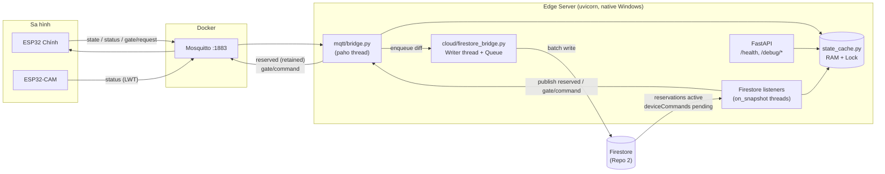

# Kế Hoạch Triển Khai Chi Tiết — Phase S3: Edge Server (FastAPI) + MQTT Bridge + State Cache + Đồng Bộ Firestore

> **Mục tiêu Phase S3:** Dựng khung **Edge Backend** (`edge-backend/app/`) chạy trên laptop tại bãi đỗ, làm "trạm trung chuyển" 2 chiều giữa **phần cứng sa hình (MQTT/Mosquitto)** và **Firebase Cloud (Repo 2)**:
> 1. **Lên Cloud:** Trạng thái cảm biến 4 ô (`sensorOccupied`), trạng thái online/offline của ESP32 chính & ESP32-CAM (LWT), sự kiện Offline Fallback → ghi vào Firestore trong **< 1 giây**.
> 2. **Xuống phần cứng:** Danh sách `reservations` đang `active` → tính mặt nạ `reserved` → publish retained xuống ESP32 (LCD/OLED trừ/cộng chỗ ngay); lệnh mở cổng khẩn cấp `deviceCommands` → publish `gate/command` (`seq = 0`).
> 3. **Nền móng cho S5:** `StateCache` trong RAM (thread-safe) để Fast Gate Arbiter đọc tức thì ở Phase S5 mà không cần truy vấn Firestore.
>
> **Ngoài phạm vi S3:** AI YOLO + EasyOCR (S4), `POST /recognize` thật + `gate_arbiter.py` + upload Storage (S5). Trong S3, `gate/request` chỉ được **ghi nhận vào cache**; ESP32 sẽ tự Fallback sau 8s — đây là hành vi **đúng và mong đợi** ở giai đoạn này.

---

## 0. Các Quyết Định Kỹ Thuật Quan Trọng (Đã Chốt ✅)

| # | Vấn đề | Quyết định đã chốt | Lý do |
|:-:|:---|:---|:---|
| 1 | **Phiên bản Python** | Tự động cài **Python 3.12** (`winget install Python.Python.3.12`) và tạo `edge-backend/.venv` bằng `py -3.12 -m venv .venv` | PyTorch/Ultralytics/EasyOCR (Phase S4) hỗ trợ wheel CUDA ổn định nhất trên 3.12. Chốt từ S3 để khỏi phải dựng lại môi trường. |
| 2 | **Chạy Edge Server ở đâu** | Chạy **native trên Windows** (`uvicorn`), Mosquitto vẫn chạy Docker | Phase S4 cần GPU NVIDIA; chạy CUDA trong Docker Windows phức tạp hơn nhiều. |
| 3 | **MQTT client** | `paho-mqtt >= 2.0` với `loop_start()` (thread riêng) | Ổn định, hỗ trợ LWT/QoS/retained, `CallbackAPIVersion.VERSION2`. |
| 4 | **Firestore client** | `firebase-admin` (sync) + **1 worker thread ghi Firestore qua hàng đợi** | Callback MQTT **không bao giờ** chờ mạng Internet → không làm chậm luồng quyết định cổng ở S5. |
| 5 | **Khi chưa có Firebase (Repo 2 chưa sẵn sàng)** | Cờ `FIREBASE_ENABLED=false` → `NullCloudBridge` (chỉ log) + **endpoint `/debug/*`** + **`scripts/simulate_gate.py`** | Test được 100% luồng MQTT ↔ phần cứng / giả lập mà không phụ thuộc Repo 2. Có thể dùng thêm **Firestore Emulator** (`FIRESTORE_EMULATOR_HOST`). |
| 6 | **Hợp đồng payload `state` & Firestore** | Bám theo **payload thực tế firmware S2 đang gửi** (mục 1.2) và **khớp 100% tên trường Firestore của Repo 2** (mục 1.3) | Tránh lệch schema giữa `src/gate/ParkingNetworkClient.cpp`, `edge-backend` và Cloud Functions `onSlotUpdate.ts` của Repo 2. |

---

## 1. Kiến Trúc Phase S3

### 1.1. Sơ đồ luồng & luồng xử lý (threads)



**Nguyên tắc luồng:**
- **paho thread:** chỉ parse JSON → cập nhật `StateCache` → đẩy job vào `queue` (O(1), không I/O mạng ngoài).
- **Firestore writer thread:** lấy job từ queue, gộp (coalesce) và ghi batch; lỗi mạng → retry backoff, không làm sập app.
- **on_snapshot threads:** cập nhật cache → gọi `bridge.publish_*()` (paho thread-safe khi publish).
- **asyncio (FastAPI):** chỉ đọc snapshot của cache để trả `/health`, `/debug/state`.

### 1.2. Hợp đồng MQTT thực tế (đồng bộ với firmware S2)

| Topic | Chiều | Payload thực tế | Edge xử lý |
|:---|:---|:---|:---|
| `parking/ESP32_PARKING_01/state` (retained) | Gate → Edge | `{"deviceId","uptime","freeSlots","totalSlots","barrierOpen","gateState","slots":{"A1":{"occupied":bool,"reserved":bool},...},"summary":{...}}` | Cập nhật `sensorOccupied[4]`, `barrierOpen`, `lastStateAt`; diff → ghi Firestore |
| `parking/ESP32_PARKING_01/gate/request` | Gate → CAM & Edge | `{"deviceId","seq","direction":"IN"/"OUT","freeSlots","timestamp"}` hoặc thêm `"offlineFallback":true` | Thường: lưu `pending_requests[seq]` (cho S5). `offlineFallback`: ghi `gateEvents` cờ `offline_fallback` |
| `parking/ESP32_PARKING_01/status` (retained, LWT) | Gate → Edge | `"online"` / `"offline"` | Cập nhật `gateOnline`; khi `online` → **publish lại `reserved`** |
| `parking/ESP32_CAM_01/status` (retained, LWT) | CAM → Edge | `"online"` / `"offline"` | Cập nhật `camOnline` |
| `parking/ESP32_PARKING_01/reserved` (retained) | Edge → Gate | `{"A1":bool,"A2":bool,"B1":bool,"B2":bool}` | Publish khi mặt nạ thay đổi / khi Gate online / khi Edge khởi động |
| `parking/ESP32_PARKING_01/gate/command` | Edge → Gate | Admin: `{"seq":0,"action":"OPEN","plate":"ADMIN_OPEN","assignedSlot":""}` | S3 chỉ dùng cho `deviceCommands`; S5 dùng cho quyết định AI |

### 1.3. Hợp đồng Firestore (Khớp 100% với mục 2.1 của Repo 2)

| Đường dẫn | Repo 1 thao tác | Trường (Chuẩn hóa theo Repo 2) |
|:---|:---|:---|
| `lots/lot_live_01/slots/{A1,A2,B1,B2}` | **Ghi** (`merge=True`) | `sensorOccupied: bool`, `updatedAt: serverTimestamp` *(Trigger `onSlotUpdate.ts` bên Repo 2 sẽ tự suy diễn `status` và `lots/lot_live_01.availableSlots`)* |
| `lots/lot_live_01` | **Ghi** (`merge=True`) | `deviceOnline: bool`, `camOnline: bool`, `edgeHeartbeatAt: serverTimestamp` *(Không ghi đè `availableSlots` của Repo 2)* |
| `devices/{ESP32_PARKING_01, ESP32_CAM_01}` | **Ghi** (`merge=True`) | `online: bool`, `lastSeen: serverTimestamp`, `lotId: "lot_live_01"`, `type: "gate"/"cam"` |
| `gateEvents/{autoId}` | **Ghi** (chỉ sự kiện offline fallback ở S3) | `deviceId, lotId, seq, direction, decision:"OPEN", status:"offline_fallback", flags:["offline_fallback"], source:"edge", serverTs` |
| `reservations` (query `lotId == lot_live_01`, `status == "active"`) | **Đọc realtime** | `slotId`, `plate`, `expiresAt` |
| `deviceCommands` (query `deviceId == ESP32_PARKING_01`, `status == "pending"`) | **Đọc realtime + cập nhật** | `action:"OPEN_GATE"`, `createdAt` → cập nhật `status:"sent"` kèm `sentAt` (hoặc `status:"failed"`, `failReason:"EXPIRED"` nếu quá hạn TTL 60s) |

> [!IMPORTANT]
> Repo 1 **không** ghi `sessions`, `payments`, `wallets`, không tính phí và không ghi đè `availableSlots` — tuân thủ tuyệt đối Phương án A. Các field trên khớp 100% với mục 2.1 của [`Plan_Repo2_Android_And_Cloud_Backend.md`](file:///f:/CodePJ/IOT-Parking/docs/Plan_Repo2_Android_And_Cloud_Backend.md).

---

## 2. Cấu Trúc File Sẽ Tạo Trong Phase S3

```
edge-backend/
├── app/
│   ├── __init__.py
│   ├── main.py                 # FastAPI + lifespan: start/stop MQTT & Cloud bridge
│   ├── config.py               # Pydantic Settings đọc .env
│   ├── logging_setup.py        # Format log thống nhất (console + file xoay vòng)
│   ├── models.py               # Pydantic schema: StatePayload, GateRequest, ReservedMask...
│   ├── state_cache.py          # StateCache thread-safe (single source of truth trong RAM)
│   ├── api/
│   │   ├── __init__.py
│   │   ├── health.py           # GET /health
│   │   └── debug.py            # GET /debug/state, POST /debug/reservations, POST /debug/open-gate (chỉ khi DEBUG=true)
│   ├── mqtt/
│   │   ├── __init__.py
│   │   └── bridge.py           # MqttBridge (paho v2): subscribe, parse, publish reserved/command
│   └── cloud/
│       ├── __init__.py
│       ├── base.py             # Interface CloudBridge
│       ├── null_bridge.py      # NullCloudBridge (FIREBASE_ENABLED=false)
│       └── firestore_bridge.py # FirestoreBridge: writer thread + listeners
├── scripts/
│   └── simulate_gate.py        # Giả lập ESP32 chính bằng paho (không cần phần cứng)
├── tests/
│   ├── conftest.py
│   ├── test_state_cache.py
│   ├── test_models.py
│   └── test_bridge_handlers.py # Test handler với fake MQTT client & fake cloud
├── requirements.txt
├── requirements-dev.txt        # pytest, pytest-asyncio, httpx
└── .env.example                # Bổ sung các biến mới (mục S3.1)
```

---

## 3. Các Bước Triển Khai (7 Steps)

### Step S3.1 — Cài đặt Python 3.12, tạo `.venv`, `config.py`, `requirements.txt`
* **Cài đặt Python 3.12 & tạo môi trường ảo:**
  * Chạy `winget install Python.Python.3.12 --silent --accept-package-agreements --accept-source-agreements` (hoặc `choco install python312 -y`).
  * Tạo môi trường ảo tại `edge-backend/.venv`: `py -3.12 -m venv edge-backend/.venv`.
* **requirements.txt:**
  ```
  fastapi>=0.115
  uvicorn[standard]>=0.30
  pydantic>=2.7
  pydantic-settings>=2.3
  paho-mqtt>=2.1
  firebase-admin>=6.5
  python-multipart>=0.0.9   # dùng cho /recognize ở S5
  ```
* **`config.py` (`Settings(BaseSettings)`)** — bổ sung vào `.env.example`:
  | Biến | Mặc định | Ghi chú |
  |:---|:---|:---|
  | `MQTT_HOST/PORT/USER/PASS` | `127.0.0.1 / 1883 / edge_server / ...` | Đã có |
  | `MQTT_CLIENT_ID` | `edge_server_01` | Mới |
  | `DEVICE_ID`, `CAM_DEVICE_ID`, `LOT_ID` | `ESP32_PARKING_01`, `ESP32_CAM_01`, `lot_live_01` | Topic sinh tự động từ `DEVICE_ID` |
  | `SLOT_IDS` | `A1,A2,B1,B2` | Thứ tự cố định khớp firmware |
  | `FIREBASE_ENABLED` | `false` | Mới |
  | `GOOGLE_APPLICATION_CREDENTIALS`, `FIREBASE_STORAGE_BUCKET` | — | Đã có |
  | `DEVICE_COMMAND_TTL_S` | `60` | Lệnh admin cũ hơn 60s → `status="failed"`, `failReason="EXPIRED"`, không mở cổng |
  | `STATE_STALE_AFTER_S` | `90` | Không nhận `state` > 90s (firmware heartbeat 30s) → cảnh báo trên `/health` |
  | `DEBUG` | `true` | Bật router `/debug/*` |
* `topics` sinh bằng property: `state`, `gate_request`, `gate_command`, `reserved`, `gate_status`, `cam_status` — **không hardcode chuỗi rải rác**.

### Step S3.2 — `state_cache.py`: StateCache thread-safe
* Dữ liệu (dataclass, bảo vệ bằng `threading.RLock`):
  * `sensor_occupied: dict[str, bool]` (4 ô), `barrier_open`, `gate_state`, `last_state_at`
  * `gate_online`, `cam_online`, `last_gate_status_at`, `last_cam_status_at`
  * `active_reservations: dict[res_id, Reservation(slot_id, plate, expires_at)]`
  * `pending_requests: dict[seq, PendingRequest(direction, received_at)]` (giữ tối đa 32, tự dọn > 60s) — dùng ở S5
  * `last_published_reserved_mask: dict[str, bool] | None`
* API chính:
  * `apply_state(payload) -> list[str]` — trả về danh sách slot **thực sự thay đổi** (để chỉ ghi diff lên Firestore).
  * `set_device_online(kind, online) -> bool` (trả về `True` nếu đổi).
  * `replace_reservations(list)` / `upsert_reservation` / `remove_reservation`.
  * `compute_reserved_mask() -> dict[str,bool]` — ô `X` reserved ⇔ có reservation active với `slotId == X` và `expiresAt > now`.
  * `reserved_mask_changed() -> dict | None` — so với mask đã publish lần cuối.
  * `free_slots_public()` = số ô `!occupied && !reserved` (khớp công thức firmware).
  * `snapshot() -> dict` — bản sao bất biến cho API/S5.

### Step S3.3 — `mqtt/bridge.py`: MqttBridge (paho-mqtt v2)
* Kết nối: `Client(CallbackAPIVersion.VERSION2, client_id=MQTT_CLIENT_ID, clean_session=True)`, `username_pw_set`, `reconnect_delay_set(1, 30)`, `connect_async` + `loop_start()` → app vẫn khởi động được dù Mosquitto chưa bật.
* `on_connect`: subscribe (QoS 1) `state`, `gate_request`, `gate_status`, `cam_status`; sau đó **publish lại `reserved` hiện tại** (retained).
* `on_message` → dispatch theo topic, mỗi handler bọc `try/except` + log (một gói tin lỗi không làm chết bridge):
  * `_on_state`: validate bằng `StatePayload` (Pydantic, `extra="ignore"`) → `cache.apply_state` → nếu có diff: `cloud.enqueue_slots(diff)` và `cloud.enqueue_lot_summary(...)`.
  * `_on_gate_request`: nếu `offlineFallback` → `cloud.enqueue_gate_event(offline_fallback)`; ngược lại → `cache.add_pending_request(seq, direction)` + log `"S3: chưa có arbiter, ESP32 sẽ fallback sau 8s"`.
  * `_on_gate_status` / `_on_cam_status`: `cache.set_device_online` → nếu đổi: `cloud.enqueue_device_status(...)`; nếu Gate chuyển `online` → `publish_reserved(force=True)`.
* Publish API (thread-safe, gọi được từ listener Firestore và từ API debug):
  * `publish_reserved(mask, force=False)` — retained, QoS 1, chỉ gửi khi đổi (trừ `force`).
  * `publish_gate_command(seq, action, plate="", assigned_slot="", reason=None)` — QoS 1, không retained.
* Trạng thái: `is_connected`, `last_message_at`, đếm số message/lỗi parse cho `/health`.

### Step S3.4 — `cloud/`: CloudBridge (Null + Firestore)
* **`base.py`**: interface `start()`, `stop()`, `enqueue_slots()`, `enqueue_lot_summary()`, `enqueue_device_status()`, `enqueue_gate_event()`, `status()`.
* **`null_bridge.py`**: chỉ log ra console — dùng khi `FIREBASE_ENABLED=false`.
* **`firestore_bridge.py`**:
  1. **Khởi tạo:** `firebase_admin.initialize_app(credentials.Certificate(...))`; tôn trọng `FIRESTORE_EMULATOR_HOST` nếu có.
  2. **Writer thread:** `queue.Queue` → mỗi vòng lấy hết job đang chờ (tối đa ~50ms), **gộp theo khóa document** (bản mới nhất thắng) → `db.batch()` → `commit()`. Lỗi → retry backoff 1s/2s/5s, quá 5 lần → log ERROR và giữ job ở đầu hàng đợi (không mất trạng thái cuối cùng).
  3. **Full sync khi khởi động / sau khi kết nối lại:** ghi toàn bộ 4 slot + online status từ cache (đề phòng Firestore lệch khi Edge tắt).
  4. **Listener `reservations`:** `where("lotId","==",LOT_ID).where("status","==","active").on_snapshot(cb)` → `cache.replace_reservations(...)` → `mask = cache.reserved_mask_changed()` → nếu khác: `bridge.publish_reserved(mask)`.
     * Kèm **timer 10s** kiểm tra `expiresAt` để tự gỡ reservation hết hạn khỏi mask (phòng khi Cloud Function của Repo 2 cập nhật `status` chậm).
  5. **Listener `deviceCommands`:** `where("deviceId","==",DEVICE_ID).where("status","==","pending")`:
     * Chỉ xử lý `change.type == ADDED`.
     * Dùng **transaction** đổi `pending → sent` *trước* khi publish (chống gửi trùng khi listener bắn lại sau reconnect).
     * `createdAt` cũ hơn `DEVICE_COMMAND_TTL_S` → đổi `status = "failed"`, `failReason = "EXPIRED"`, **không** mở cổng.
     * `action == "OPEN_GATE"` → `bridge.publish_gate_command(seq=0, action="OPEN", plate="ADMIN_OPEN")`.
  6. **Heartbeat Edge:** mỗi 30s ghi `lots/{LOT_ID}.edgeHeartbeatAt` để Web Admin biết Edge còn sống.
  7. **Tự phục hồi listener:** on_snapshot báo lỗi → hủy & đăng ký lại sau 5s.

### Step S3.5 — `main.py` + API
* **Lifespan:** `setup_logging()` → tạo `StateCache` → `MqttBridge(cache)` → `cloud = FirestoreBridge(...) if FIREBASE_ENABLED else NullCloudBridge()` → nối tham chiếu chéo (`bridge.cloud = cloud`, `cloud.bridge = bridge`) → `cloud.start()` → `bridge.start()`. Khi tắt: `bridge.stop()` (disconnect sạch) → `cloud.stop()` (flush hàng đợi tối đa 3s).
* **`GET /health`:**
  ```json
  {
    "status": "ok | degraded",
    "mqtt": {"connected": true, "lastMessageAgoS": 2.1, "parseErrors": 0},
    "cloud": {"mode": "firestore | null", "connected": true, "queueSize": 0, "listeners": {"reservations": "ok", "deviceCommands": "ok"}},
    "devices": {"gateOnline": true, "camOnline": true, "lastStateAgoS": 12.4, "stateStale": false},
    "lot": {"sensorOccupied": {"A1": false, ...}, "reservedMask": {...}, "freeSlotsPublic": 3}
  }
  ```
  `degraded` khi MQTT mất kết nối, state stale, hoặc Cloud lỗi.
* **`/debug/*`** (chỉ khi `DEBUG=true`, để test khi chưa có Repo 2):
  * `GET /debug/state` → `cache.snapshot()`.
  * `POST /debug/reservations` `{"slotId":"B1","plate":"51A12345","ttlS":300}` → thêm reservation giả vào cache → publish mask.
  * `DELETE /debug/reservations/{slotId}` → gỡ → publish mask.
  * `POST /debug/open-gate` → `publish_gate_command(seq=0, "OPEN")`.

### Step S3.6 — Script giả lập & Unit test
* **`scripts/simulate_gate.py`** (paho, đăng nhập `esp32_gate_01`): giả lập ESP32 chính — publish `status online` (LWT `offline`), `state` mỗi lần gõ lệnh (`occupy A1`, `free A1`, `request IN`, `fallback 5 IN`), in ra mọi `reserved`/`gate/command` nhận được. Giúp test S3 **không cần cắm phần cứng**.
* **Unit test (pytest)** — không cần Mosquitto/Firebase:
  * `test_state_cache.py`: diff slot đúng; mask reserved đúng (kể cả reservation hết hạn); `free_slots_public` khớp công thức firmware; thread-safety cơ bản (2 thread cập nhật song song).
  * `test_models.py`: parse đúng payload firmware S2 thật; bỏ qua field lạ; từ chối JSON hỏng.
  * `test_bridge_handlers.py`: dùng `FakeMqttClient` + `FakeCloud` → `state` tạo đúng job cloud; Gate `online` → publish lại `reserved`; `offlineFallback` → tạo `gate_event`; publish `reserved` chỉ khi đổi.

### Step S3.7 — Cập nhật tài liệu
* Sửa bảng **4.1** trong [`Plan_Repo1_IoT_And_Edge_Backend.md`](file:///f:/CodePJ/IOT-Parking/docs/Plan_Repo1_IoT_And_Edge_Backend.md) cho khớp payload thực tế của firmware S2 (mục 1.2).
* Bổ sung mục **1.3 (Hợp đồng Firestore)** vào [`Plan_Repo2_Android_And_Cloud_Backend.md`](file:///f:/CodePJ/IOT-Parking/docs/Plan_Repo2_Android_And_Cloud_Backend.md) để Repo 2 tạo đúng schema/index (`reservations: lotId + status`, `deviceCommands: deviceId + status` cần **composite index**).
* Đánh dấu tiến độ S3 trong [`Repo1_Execution_Plan.md`](file:///f:/CodePJ/IOT-Parking/docs/Repo1_Execution_Plan.md) và bảng tiến độ plan tổng.

---

## 4. Kế Hoạch Kiểm Thử Phase S3

| Mã | Kịch bản | Cách thực hiện | Kết quả mong đợi |
|:---:|:---|:---|:---|
| **S3-T1** | Edge khởi động khi Mosquitto tắt | Tắt container → chạy `uvicorn` → bật lại container | App không crash; `/health` từ `degraded` → `ok` khi broker lên |
| **S3-T2** | Cảm biến ô đỗ → Cloud | Che cảm biến `A1` trên sa hình (hoặc `simulate_gate.py: occupy A1`) | Log diff `A1: false→true`; Firestore `slots/A1.sensorOccupied = true` trong **< 1s** |
| **S3-T3** | LWT online/offline | Rút nguồn ESP32 chính | Sau keepalive (~15–20s) `devices/ESP32_PARKING_01.online = false`, `/health.gateOnline = false` |
| **S3-T4** | Reservation → LCD/OLED | `POST /debug/reservations {"slotId":"B1",...}` (hoặc tạo doc `reservations` trên Firestore) | ESP32 nhận `reserved {"B1":true}` → LCD giảm 1 chỗ, OLED hiện `B1:R` **ngay lập tức** |
| **S3-T5** | Khôi phục sau reset (ST-06) | Đang có `B1` reserved → reset cứng ESP32 | Kết nối lại nhận retained + Edge publish lại → LCD vẫn trừ đúng |
| **S3-T6** | Reservation hết hạn | Reservation `ttlS=30` | Sau ≤ 40s, mask `B1` tự về `false`, LCD cộng lại chỗ |
| **S3-T7** | Mở cổng Admin (ST-07) | Tạo doc `deviceCommands {action:"OPEN_GATE", status:"pending"}` (hoặc `POST /debug/open-gate`) | Barie mở **< 1s**; doc đổi `status = "sent"`; tạo lại listener không gửi trùng |
| **S3-T8** | Lệnh Admin quá hạn | Tạo `deviceCommands` có `createdAt` cũ 5 phút | Doc → `status = "failed"`, `failReason = "EXPIRED"`, barie **không** mở |
| **S3-T9** | Offline fallback đồng bộ bù | Tắt Edge → xe chạm cổng (ESP32 tự mở sau 8s) → bật Edge | Edge nhận gói `offlineFallback:true` → tạo `gateEvents` cờ `offline_fallback` |
| **S3-T10** | Mất Internet | Ngắt mạng Internet (giữ LAN) → che/bỏ cảm biến vài lần → bật lại | MQTT ↔ ESP32 vẫn chạy bình thường; hàng đợi Firestore tăng rồi xả hết, Firestore khớp trạng thái cuối |
| **S3-T11** | Unit test | `pytest -q` trong `edge-backend/` | 100% pass |

---

## 5. Tiêu Chí Hoàn Thành (Definition of Done)

1. `uvicorn app.main:app --host 0.0.0.0 --port 8000` khởi động sạch ở cả 2 chế độ `FIREBASE_ENABLED=false/true`.
2. Pass toàn bộ **S3-T1 → S3-T11** (S3-T2, T3, T7, T8, T9 với Firestore thật hoặc Emulator khi Repo 2 sẵn sàng).
3. Callback MQTT không có I/O mạng ngoài; độ trễ từ lúc nhận `state` đến lúc gọi `batch.commit()` **< 200ms** (đo bằng log).
4. Không ghi bất kỳ dữ liệu tài chính/phiên nào lên Firestore (đúng Phương án A).
5. Tài liệu (mục S3.7) đã cập nhật, đánh dấu **Phase S3 ✅ 100%**.

---

## 6. Rủi Ro & Phương Án Dự Phòng

| Rủi ro | Ảnh hưởng | Phương án |
|:---|:---|:---|
| Repo 2 chưa có Firebase project / schema | Không test được chiều Cloud | `FIREBASE_ENABLED=false` + `/debug/*`; hoặc Firestore Emulator (`firebase emulators:start --only firestore`) |
| Thiếu composite index cho query listener | `on_snapshot` báo lỗi `FAILED_PRECONDITION` | Log in sẵn link tạo index; ghi vào hợp đồng Repo 2 (S3.7) |
| Windows Firewall chặn cổng 8000 / 1883 | ESP32 không kết nối được | Mở inbound rule cho `python.exe` và Docker Desktop (đã gặp ở bài test CAM) |
| ESP32 publish `state` dồn dập khi cảm biến rung | Tốn quota ghi Firestore | Firmware đã debounce 250ms + Edge chỉ ghi diff + coalesce trong cửa sổ 50ms |
| Lệnh admin bị gửi 2 lần khi listener reconnect | Barie mở thừa | Transaction `pending → sent` trước khi publish + TTL 60s |

