# Kế Hoạch Triển Khai Chi Tiết — Phase S4: Dataset Sa Hình & Pipeline AI Nhận Diện Biển Số (YOLO + EasyOCR trên GPU NVIDIA)

> **Mục tiêu Phase S4:** Xây dựng hoàn chỉnh **Pipeline AI Nhận diện Biển số xe Việt Nam** (`edge-backend/app/recognition/`) tận dụng sức mạnh **GPU NVIDIA GeForce RTX 5060 (8GB VRAM)** trên máy tính trạm, cùng bộ công cụ thu thập dữ liệu từ ESP32-CAM và kiểm thử độc lập:
> 1. **Chuẩn hóa & Hậu xử lý Biển số VN (`plate_utils.py`):** Chuẩn hóa chuỗi, tự động sửa lỗi nhầm ký tự OCR theo ngữ cảnh vị trí biển số Việt Nam, kiểm tra Regex đồng bộ 100% với Repo 2 (`tests/plate_test_cases.json`), và cơ chế **Multi-frame Voting** chọn biển tốt nhất từ 2 ảnh chụp liên tiếp.
> 2. **Phát hiện vùng biển số (`detector.py`):** Hỗ trợ **YOLOv8s/11s (CUDA)** khi có trọng số `models/plate_yolo_s.pt`, kèm cơ chế **3-Tier Fallback** (OpenCV Morphological/Contour Localization + Full-frame ROI) giúp hệ thống đọc được biển số ngay cả khi chưa kịp fine-tune YOLO.
> 3. **Tiền xử lý & Đọc ký tự (`ocr.py`):** OpenCV (`Grayscale` → `Resize 2x` → `CLAHE` → `Bilateral Filter`) + **EasyOCR (`gpu=True`)** + thuật toán phân cụm tọa độ `(X, Y)` để ghép chuẩn xác cả **biển 1 dòng** (ô tô dài) và **biển 2 dòng** (ô tô vuông / xe máy / biển mô hình sa hình).
> 4. **Pipeline Hợp nhất & GPU Warm-up (`pipeline.py`):** Nạp sẵn model vào VRAM ngay khi khởi động FastAPI (`lifespan`), loại bỏ độ trễ lần chạy đầu tiên; thời gian xử lý mục tiêu **< 400ms / lượt** (2 frames).
> 5. **Công cụ Thu thập Dataset & Benchmark (`scripts/`):** Script kích hoạt ESP32-CAM chụp ảnh lưu dataset (`capture_dataset.py`), script sinh ảnh biển số giả lập (`generate_synthetic_plates.py`) và script đo hiệu năng GPU (`benchmark_pipeline.py`).
>
> **Ngoài phạm vi S4:** Logic quyết định mở cổng `gate_arbiter.py`, hẹn giờ 5s và luồng ghi `gateEvents` / upload ảnh lên Firebase Storage sẽ được thực hiện ở **Phase S5**. Trong S4, chúng ta mở thêm endpoint `POST /debug/recognize-test` để test trực tiếp AI qua Swagger UI (`/docs`).

---

## 0. Các Phát Hiện & Đề Xuất Kỹ Thuật Trọng Tâm

| # | Hạng mục | Thực trạng & Đề xuất giải pháp | Lý do kỹ thuật |
|:-:|:---|:---|:---|
| 1 | **GPU Phần cứng** | Máy trạm đang trang bị **NVIDIA GeForce RTX 5060 (8GB VRAM, Driver 610.88, CUDA 13.3)** — kiến trúc Blackwell (`sm_120`).<br/>👉 **Giải pháp:** Cài đặt PyTorch từ index chính thức **CUDA 12.8 (`cu128`)** (`--index-url https://download.pytorch.org/whl/cu128`) để hỗ trợ tập lệnh `sm_120` của RTX 50-series. | Nếu cài `torch` mặc định từ PyPI sẽ là bản CPU-only; nếu cài `cu121`/`cu124` cũ sẽ không chạy được trên kiến trúc Blackwell `sm_120`. |
| 2 | **Model YOLOv8 (`.pt`) & Dataset thực tế `yolo_plate_dataset/`** | Phát hiện thư mục [`yolo_plate_dataset/`](file:///f:/CodePJ/IOT-Parking/yolo_plate_dataset) có sẵn **8.259 ảnh `.jpg` + 8.260 nhãn `.txt` chuẩn YOLO (`class 0`)** chụp trực tiếp tại làn cổng bãi giữ xe VN (`CarLongPlate*` biển 1 dòng như `51F-222.61`, `xemay*` biển 2 dòng như `59-H1 549.86`).<br/>👉 **Giải pháp:**<br/>• **Tầng 1:** Tải sẵn trọng số YOLOv8 chuyên biển số VN (`models/plate_yolo_s.pt`) — hoặc fine-tune nhanh từ `yolo_plate_dataset` trên RTX 5060.<br/>• **Tầng 2:** OpenCV Contour/Blackhat Fallback dựa trên nhãn/cắt vùng.<br/>• **Kiểm thử thực tế:** Dùng trực tiếp ảnh thật trong `yolo_plate_dataset/` để test IoU phát hiện biển số và độ chính xác OCR 1 dòng / 2 dòng! | Góc chụp của `yolo_plate_dataset` là góc camera cổng soát vé chiếu xuống đầu/đuôi xe — trùng khớp hoàn toàn với góc lắp ESP32-CAM trên sa hình bãi đỗ. |
| 3 | **Kiểm thử trên Ảnh Thật (`yolo_plate_dataset`)** | Chọn bộ mẫu chuẩn từ `yolo_plate_dataset/` (gồm cả biển ô tô 1 dòng `CarLongPlate*` và biển 2 dòng `xemay*`, `xemayBigPlate*`) kèm nhãn bounding box `.txt` và biển số thực tế để chạy `benchmark_pipeline.py`. | Kiểm chứng khách quan bằng **ảnh camera bãi xe thật tại Việt Nam**: đo cả **Detection IoU** (so với file `.txt`), **OCR Accuracy (%)** và **GPU Latency (< 400ms)**. |
| 4 | **Đồng bộ Regex biển số với Repo 2** | Tạo `edge-backend/tests/plate_test_cases.json` dùng chung chuẩn định dạng với Repo 2: chuẩn hóa `51A-123.45` → `51A12345`, hỗ trợ cả biển ô tô (7–8 ký tự) và xe máy (8–9 ký tự). | Đảm bảo biển số đọc từ Edge Server khớp tuyệt đối với `reservations.plate` và `vehicles.plateNormalized` trên Firestore của Repo 2. |

---

## 1. Kiến Trúc Pipeline AI Nhận Diện Biển Số (Phase S4)

### 1.1. Sơ đồ luồng xử lý (2 Frames / Lượt)

```mermaid
flowchart LR
    subgraph INPUT["Đầu vào (Từ ESP32-CAM hoặc API Test)"]
        F1["Frame 1 (JPEG 800x600)"]
        F2["Frame 2 (JPEG 800x600)"]
    end

    subgraph DET["Bước 1: Phát hiện vùng biển (detector.py)"]
        YOLO["Tầng 1: YOLOv8s/11s (CUDA)<br/>conf >= 0.5 + Padding 8%"]
        CV["Tầng 2: OpenCV Blackhat/Contour<br/>(Fallback khi chưa có .pt)"]
    end

    subgraph OCR["Bước 2: Tiền xử lý & Đọc chữ (ocr.py)"]
        PRE["Grayscale -> Resize 2x<br/>-> CLAHE -> Bilateral Filter"]
        EASY["EasyOCR (gpu=True)<br/>Allowlist: A-Z, 0-9"]
        MERGE["Phân cụm trục Y -> X<br/>Ghép biển 1 dòng / 2 dòng"]
    end

    subgraph POST["Bước 3: Hậu xử lý & Bầu chọn (plate_utils.py)"]
        FIX["Chuẩn hóa & Sửa ký tự nhầm<br/>theo vị trí biển số VN"]
        REG["Kiểm tra Regex VN<br/>^[1-9][0-9][A-Z][A-Z0-9]?[0-9]{4,5}$"]
        VOTE["Multi-frame Voting<br/>(Chọn biển hợp lệ có conf cao nhất)"]
    end

    F1 & F2 --> YOLO
    YOLO -. "Nếu thiếu model / 0 box" .-> CV
    YOLO & CV -- "Ảnh Crop Biển số" --> PRE
    PRE --> EASY --> MERGE --> FIX --> REG --> VOTE
    VOTE --> OUT["Kết quả cuối cùng:<br/>RecognitionResult(plateNormalized, plateDisplay, confidence, isValid, cropJpeg, latencyMs)"]
```



---

### 1.2. Quy tắc Chuẩn hóa & Sửa lỗi Ký tự Biển số Việt Nam (`plate_utils.py`)

Biển số xe tại Việt Nam (sau khi bỏ dấu `-`, `.`, khoảng trắng) có cấu trúc chặt chẽ:
- **Biển ô tô:** `[2 số mã tỉnh][1 chữ seri][1 số/chữ phụ tùy chọn][4 hoặc 5 số cuối]` — Độ dài **7 hoặc 8 ký tự** (VD: `51A1234`, `51A12345`, `30E88888`, `29LD12345`).
- **Biển xe máy:** `[2 số mã tỉnh][1 chữ seri][1 số/chữ seri thứ 2][4 hoặc 5 số cuối]` — Độ dài **8 hoặc 9 ký tự** (VD: `59X112345`, `29B19999`, `43AA12345`).

#### Bảng ánh xạ sửa lỗi nhầm ký tự OCR theo vị trí (`correct_ocr_confusions`):
Chỉ áp dụng sửa lỗi cho chuỗi có độ dài từ **7 đến 9 ký tự**:

| Vị trí ký tự (0-indexed) | Bản chất bắt buộc | Quy tắc sửa lỗi khi OCR đọc nhầm |
|:---|:---|:---|
| **Vị trí `0`, `1`** (2 ký tự đầu — Mã tỉnh `11..99`) | **BẮT BUỘC LÀ SỐ (`0-9`)** | `O, Q, D, U → 0` \| `I, L, J → 1` \| `Z → 2` \| `S → 5` \| `G → 6` \| `B → 8` \| `A → 4` |
| **Vị trí `2`** (Ký tự thứ 3 — Seri chữ cái) | **BẮT BUỘC LÀ CHỮ (`A-Z`)** | `0 → D` \| `8 → B` \| `5 → S` \| `1 → T` \| `2 → Z` \| `4 → A` \| `6 → G` |
| **Vị trí `3`** (Ký tự thứ 4) | **Số hoặc Chữ** (tùy biển ô tô / xe máy) | • Nếu tổng độ dài là **7 ký tự** (biển 4 số kiểu cũ `51A1234`): vị trí `3` thuộc cụm 4 số cuối → **ép sang SỐ**.<br/>• Nếu tổng độ dài là **8 ký tự** (`51A12345` hoặc `29B12345`): vị trí `3` có thể là số đầu của cụm 5 số (ô tô) hoặc số seri xe máy → nếu là chữ dễ nhầm (`O, I, Z, S, B`) và 4 ký tự cuối đều là số → **ép sang SỐ**.<br/>• Nếu tổng độ dài là **9 ký tự** (`59X112345`): vị trí `3` là ký tự thứ 2 của seri xe máy (giữ nguyên), 5 ký tự cuối (`4..8`) ép sang SỐ. |
| **4 ký tự cuối (`-4..-1`)** (hoặc 5 ký tự cuối với biển 9 ký tự) | **BẮT BUỘC LÀ SỐ (`0-9`)** | `O, Q, D, U → 0` \| `I, L, J, T → 1` \| `Z → 2` \| `S → 5` \| `G → 6` \| `B → 8` \| `A → 4` |

#### Biểu thức chính quy (Regex) kiểm tra tính hợp lệ:
```python
VN_PLATE_REGEX = re.compile(r"^[1-9][0-9][A-Z][A-Z0-9]?[0-9]{4,5}$")
```
- Khớp hoàn toàn với cả biển ô tô và xe máy Việt Nam.
- Từ chối mã tỉnh bắt đầu bằng số `0` (ở VN mã tỉnh từ `11` Cao Bằng đến `99` Bắc Ninh).

---

### 1.3. Thuật toán Ghép Biển 1 Dòng & 2 Dòng (`ocr.py`)

Trên sa hình cũng như thực tế, biển số thường có **2 dòng** (VD dòng trên `51A`, dòng dưới `123.45`). Nếu chỉ nối chuỗi theo thứ tự mặc định của EasyOCR, đôi khi các box bị đảo lộn nếu biển hơi nghiêng.

**Thuật toán `merge_ocr_boxes(detections)`:**
1. Với mỗi box `([[x1,y1],[x2,y2],[x3,y3],[x4,y4]], text, conf)`:
   - Tính tâm `cx = mean(x)`, `cy = mean(y)` và chiều cao `h = max(y) - min(y)`.
   - Lọc bỏ các box nhiễu quá nhỏ (`conf < 0.2` hoặc `h < 10px`).
2. Nếu chỉ có 1 box: trả về luôn `text, conf`.
3. Sắp xếp các box theo `cy` tăng dần. Tính chiều cao trung bình `mean_h`.
4. **Tách dòng (Line Clustering):**
   - Khởi tạo dòng đầu tiên với box có `cy` nhỏ nhất.
   - Duyệt các box tiếp theo: nếu `abs(box.cy - current_line_mean_cy) <= 0.55 * mean_h` → cùng dòng; ngược lại → tách sang dòng mới.
5. Trong từng dòng, sắp xếp các box từ trái sang phải theo `cx` tăng dần.
6. Nối toàn bộ ký tự của dòng trên trước, dòng dưới sau; điểm tự tin trung bình có trọng số theo độ dài chuỗi mỗi box.

---

## 2. Cấu Trúc File Sẽ Tạo / Cập Nhật Trong Phase S4

```
edge-backend/
├── app/
│   ├── config.py                        # [Cập nhật] Thêm cấu hình AI (USE_GPU, PADDING, FALLBACK...)
│   ├── main.py                          # [Cập nhật] Khởi tạo & Warm-up AI Pipeline trong lifespan
│   ├── api/
│   │   ├── health.py                    # [Cập nhật] Bổ sung trường "ai" (gpuAvailable, device, warmupDone...)
│   │   └── debug.py                     # [Cập nhật] Thêm POST /debug/recognize-test (upload ảnh test AI)
│   └── recognition/                     # [MỚI] Toàn bộ package AI nhận diện biển số
│       ├── __init__.py
│       ├── plate_utils.py               # Chuẩn hóa, sửa ký tự nhầm, Regex VN, format hiển thị, Voting
│       ├── detector.py                  # YOLOv8/11 CUDA + OpenCV Morphological/Contour Fallback
│       ├── ocr.py                       # Tiền xử lý OpenCV (CLAHE, Bilateral) + EasyOCR + ghép 2 dòng
│       └── pipeline.py                  # PlateRecognitionPipeline hợp nhất + CUDA Warm-up
├── models/
│   └── .gitkeep                         # Thư mục chứa plate_yolo_s.pt (sau khi fine-tune)
├── scripts/
│   ├── simulate_gate.py                 # (Đã có từ S3)
│   ├── capture_dataset.py               # [MỚI] Thu thập ảnh từ ESP32-CAM thật qua MQTT + HTTP
│   ├── generate_synthetic_plates.py     # [MỚI] Sinh bộ ảnh biển số VN giả lập để test/benchmark ngay
│   └── benchmark_pipeline.py            # [MỚI] Đo tốc độ (ms) và độ chính xác (%) trên GPU RTX 5060
├── tests/
│   ├── plate_test_cases.json            # [MỚI] Bộ test vector chuẩn hóa biển số đồng bộ với Repo 2
│   ├── test_plate_utils.py              # [MỚI] Unit test plate_utils với plate_test_cases.json + voting
│   └── test_recognition_pipeline.py     # [MỚI] Test tích hợp detector + ocr + pipeline với ảnh tổng hợp
└── requirements.txt                     # [Cập nhật] Thêm opencv-python-headless, numpy, ultralytics, easyocr
```

---

## 3. Các Bước Triển Khai Chi Tiết (6 Steps)

### Step S4.1 — Cài đặt PyTorch CUDA (`cu128` cho RTX 5060), OpenCV, Ultralytics, EasyOCR
* **Cài đặt PyTorch hỗ trợ CUDA trên `.venv`:**
  * Chạy lệnh cài đặt bản `cu128` (hỗ trợ kiến trúc Blackwell `sm_120` của RTX 5060):
    ```powershell
    edge-backend\.venv\Scripts\pip.exe install torch torchvision --index-url https://download.pytorch.org/whl/cu128
    ```
  * Cài đặt các thư viện thị giác máy tính và AI:
    ```powershell
    edge-backend\.venv\Scripts\pip.exe install opencv-python-headless numpy ultralytics easyocr
    ```
* **Kiểm chứng GPU ngay sau khi cài:**
  * Kiểm tra `torch.cuda.is_available() == True`, `torch.cuda.get_device_name(0) == "NVIDIA GeForce RTX 5060"`, và chạy thử 1 phép nhân tensor trên `cuda:0` đảm bảo kernel `sm_120` thực thi mượt mà.
* **Cập nhật `edge-backend/requirements.txt`** để ghi nhận đầy đủ các thư viện Phase S4.

### Step S4.2 — Xây dựng `plate_utils.py` & Bộ Test Vector `plate_test_cases.json`
* **Tạo `edge-backend/tests/plate_test_cases.json`:**
  * Chứa ≥ 25 test cases bao phủ:
    1. Biển ô tô 1 dòng & 2 dòng hợp lệ (`"51A-123.45"` → `"51A12345"`, `"30E - 888.88"` → `"30E88888"`, `"29A-1234"` → `"29A1234"`).
    2. Biển xe máy hợp lệ (`"59-X1 123.45"` → `"59X112345"`, `"29-B1 9999"` → `"29B19999"`).
    3. Các ca OCR đọc nhầm ký tự điển hình được tự động cứu sống:
       - Nhầm số thành chữ ở mã tỉnh: `"S1A-123.45"` → `"51A12345"`, `"O9A-12345"` → không hợp lệ (mã tỉnh `09`), `"B0A-12345"` → `"80A12345"`.
       - Nhầm chữ thành số ở seri: `"514-123.45"` → `"51A12345"`, `"308-888.88"` → `"30B88888"`, `"510-123.45"` → `"51D12345"`.
       - Nhầm số thành chữ ở đuôi: `"51A-123.4S"` → `"51A12345"`, `"51A-I23.4O"` → `"51A12340"`, `"29A-8B8.8B"` → `"29A88888"`.
    4. Các chuỗi rác / không phải biển số (`"HELLO"`, `"123"`, `"00A12345"`, `"ABCDEFGH"`) → `isValid = false`.
* **Hiện thực `edge-backend/app/recognition/plate_utils.py`:**
  * `clean_raw_text(raw: str) -> str`
  * `correct_ocr_confusions(cleaned: str) -> str`
  * `is_valid_vn_plate(plate: str) -> bool`
  * `normalize_plate(raw: str) -> PlateValidationResult(plate_raw, plate_normalized, plate_display, is_valid)`
  * `format_plate_display(plate_norm: str) -> str`
  * `vote_best_candidate(candidates: list[PlateCandidate]) -> PlateCandidate`

### Step S4.3 — Xây dựng `detector.py` (YOLO CUDA + OpenCV Fallback) & `ocr.py` (EasyOCR + 2-Line Merge)
* **`edge-backend/app/recognition/detector.py` (`PlateDetector`):**
  * Khi khởi tạo: kiểm tra file `settings.YOLO_MODEL_PATH` (`models/plate_yolo_s.pt`).
    * Nếu tồn tại: nạp `YOLO(model_path)` và chuyển sang `cuda:0` (nếu có GPU).
    * Nếu chưa tồn tại: ghi log `INFO` chuyển sang chế độ **OpenCV Morphological Plate Localizer** (không báo lỗi, không crash).
  * Phương thức `detect_and_crop(img_bgr: np.ndarray) -> list[DetectedRegion]`:
    * Nếu có YOLO: chạy `model.predict(img_bgr, conf=settings.YOLO_CONF_THRESHOLD, verbose=False)`, mở rộng bounding box thêm **padding 8%** mỗi cạnh.
    * Nếu không có YOLO (hoặc YOLO không tìm thấy box nào): chạy thuật toán OpenCV (`Grayscale` → `Blackhat / Sobel X` → `Morphological Close` → `findContours` lọc theo tỷ lệ `1.0 <= w/h <= 6.0` và diện tích) để cắt tối đa 2 vùng nghi ngờ nhất, đồng thời luôn kèm theo 1 vùng crop trung tâm khung hình (Full/Center ROI) để đảm bảo EasyOCR luôn có dữ liệu đọc.
* **`edge-backend/app/recognition/ocr.py` (`PlateOCR`):**
  * Khởi tạo `easyocr.Reader(['en'], gpu=use_gpu, verbose=False)`.
  * Phương thức `preprocess(crop_bgr: np.ndarray) -> np.ndarray`:
    * Chuyển xám → Phóng đại `2x` nếu ảnh nhỏ → `CLAHE` → `Bilateral Filter`.
  * Phương thức `read_crop(crop_bgr: np.ndarray) -> tuple[str, float]`:
    * Gọi `reader.readtext(processed_img, allowlist='0123456789ABCDEFGHIJKLMNOPQRSTUVWXYZ', detail=1, paragraph=False)`.
    * Chạy thuật toán `merge_ocr_boxes()` phân cụm dòng `Y` rồi sắp xếp cột `X` để ghép chính xác biển 1 dòng và 2 dòng.

### Step S4.4 — Xây dựng `pipeline.py`, Tích hợp `lifespan` Warm-up & Debug Endpoint
* **`edge-backend/app/recognition/pipeline.py` (`PlateRecognitionPipeline`):**
  * Hàm `recognize_frames(frames_bytes: list[bytes]) -> PipelineResult`:
    1. Giải mã từng mảng byte JPEG sang `np.ndarray` (`cv2.imdecode`).
    2. Với mỗi frame, gọi `detector.detect_and_crop()`.
    3. Với mỗi vùng crop, gọi `ocr.read_crop()` → đưa qua `plate_utils.normalize_plate()`.
    4. Dùng `vote_best_candidate()` chọn kết quả tốt nhất giữa tất cả các frame.
    5. Mã hóa vùng ảnh biển số tốt nhất (`best_crop`) thành JPEG bytes để sẵn sàng cho việc upload lên Cloud Storage ở Phase S5.
    6. Trả về `PipelineResult(plate_raw, plate_normalized, plate_display, confidence, is_valid, crop_jpeg_bytes, best_frame_index, latency_ms, detector_used)`.
  * Hàm `warmup()`:
    * Tạo 1 ảnh biển số giả lập trong RAM (`51A-123.45`), chạy `recognize_frames()` 1 lần khi server khởi động để nạp đầy đủ kernel CUDA của cả PyTorch/YOLO và EasyOCR vào VRAM.
* **Cập nhật `app/main.py`, `app/api/health.py`, `app/api/debug.py`:**
  * Trong `main.py` (`lifespan`): Khởi tạo `app.state.ai_pipeline = PlateRecognitionPipeline(...)` và gọi `warmup()` (bỏ qua khi `app.state.test_mode == True` để unit test API vẫn chạy trong 0.05s).
  * Trong `GET /health`: Thêm block `"ai"` báo cáo `gpuAvailable`, `deviceName`, `detectorMode` (`"yolo_cuda"` / `"opencv_fallback"`), `warmupDone`, `lastLatencyMs`.
  * Trong `POST /debug/recognize-test`: Cho phép upload 1 hoặc nhiều ảnh JPEG trực tiếp từ trình duyệt (`/docs`) hoặc script để xem ngay kết quả đọc biển số và thời gian xử lý.

### Step S4.5 — Khai thác `yolo_plate_dataset/` (Train/Download `plate_yolo_s.pt` & Benchmark GPU trên Ảnh Thật)
* **Chuẩn bị trọng số `edge-backend/models/plate_yolo_s.pt`:**
  * Tải sẵn model YOLOv8 chuyên biển số Việt Nam (`plate_yolo_s.pt`) — hoặc dùng script `edge-backend/scripts/train_yolo_from_dataset.py` để fine-tune nhanh trên tập con của [`yolo_plate_dataset/`](file:///f:/CodePJ/IOT-Parking/yolo_plate_dataset) bằng GPU RTX 5060.
* **`edge-backend/scripts/benchmark_pipeline.py` (Kiểm thử trực tiếp trên `yolo_plate_dataset/`):**
  * Chọn tập mẫu kiểm thử thực tế từ `f:\CodePJ\IOT-Parking\yolo_plate_dataset` (gồm các ảnh ô tô 1 dòng `CarLongPlate*.jpg` và xe máy 2 dòng `xemay*.jpg`, `xemayBigPlate*.jpg` kèm nhãn `.txt` chuẩn YOLO).
  * Chạy toàn bộ qua `PlateRecognitionPipeline` trên GPU RTX 5060:
    1. Đo **Detection IoU** so với nhãn `.txt` trong `yolo_plate_dataset`.
    2. Đo **OCR Accuracy (%)** so với biển số thật trên ảnh.
    3. Đo **Mean / P95 / Max Latency (ms)** trên GPU RTX 5060 (mục tiêu **< 400ms/lượt**).
* **`edge-backend/scripts/capture_dataset.py`:**
  * Công cụ dành riêng cho lúc cắm mạch ESP32-CAM thật:
    * Mở cổng lắng nghe HTTP nhận ảnh từ CAM và lưu tự động vào `edge-backend/dataset/raw/` kèm tên file đánh số thứ tự.
    * Tích hợp nút bấm trên bàn phím (`Enter` để bắn MQTT `gate/request` kích hoạt CAM nháy đèn chụp ảnh ngay lập tức).

### Step S4.6 — Kiểm thử Tự động (`pytest`) & Cập nhật Tài liệu
* Viết `edge-backend/tests/test_plate_utils.py`:
  * Chạy toàn bộ test vector trong `tests/plate_test_cases.json`.
  * Kiểm thử logic sửa lỗi ký tự nhầm và Multi-frame Voting.
* Viết `edge-backend/tests/test_recognition_pipeline.py`:
  * Kiểm thử `merge_ocr_boxes` (biển 1 dòng, biển 2 dòng, biển nghiêng).
  * Kiểm thử toàn bộ pipeline từ ảnh JPEG tổng hợp → ra đúng biển số `51A12345`.
* Cập nhật tiến độ Phase S4 trong `docs/Repo1_Execution_Plan.md` và `docs/Plan_Repo1_IoT_And_Edge_Backend.md`.

---

## 4. Kế Hoạch Kiểm Thử Nghiệm Thu Phase S4

| Mã TC | Hạng mục | Kịch bản kiểm thử | Kết quả mong đợi |
|:---:|:---|:---|:---|
| **S4-T1** | Nhận diện GPU CUDA | Kiểm tra `torch.cuda.is_available()` và `/health` trường `ai` | `gpuAvailable = true`, `deviceName = "NVIDIA GeForce RTX 5060"`, `warmupDone = true` |
| **S4-T2** | Hợp đồng `plate_test_cases.json` | Chạy `pytest tests/test_plate_utils.py` | Pass **100%** toàn bộ ≥ 25 test cases (chuẩn hóa, sửa lỗi nhầm vị trí, regex VN) |
| **S4-T3** | Ghép biển 2 dòng | Đưa ảnh biển số 2 dòng (`51A` ở dòng trên, `123.45` ở dòng dưới) vào pipeline | Đọc và ghép đúng thứ tự thành `51A12345` (`plateDisplay = "51A-123.45"`) |
| **S4-T4** | Multi-frame Voting | Frame 1 bị mờ đọc ra `51A123` (không hợp lệ, conf 0.8), Frame 2 đọc ra `51A12345` (hợp lệ, conf 0.75) | Hệ thống ưu tiên chọn `51A12345` vì khớp Regex biển số Việt Nam |
| **S4-T5** | Hiệu năng & Độ chính xác | Chạy `python scripts/benchmark_pipeline.py` với bộ 30 ảnh biển số 1 dòng & 2 dòng | **Accuracy ≥ 90%**, thời gian xử lý trung bình trên GPU **< 400ms / lượt** |
| **S4-T6** | API Test trực tiếp | Gửi ảnh JPEG qua `POST /debug/recognize-test` | Trả về HTTP 200 kèm JSON `plateNormalized`, `plateDisplay`, `confidence`, `latencyMs` |

---

## 5. Tiêu Chí Hoàn Thành (Definition of Done)

1. Môi trường `.venv` cài đặt thành công PyTorch CUDA (`cu128`), OpenCV, Ultralytics, EasyOCR và nhận diện đúng GPU **NVIDIA GeForce RTX 5060**.
2. Hoàn thiện đầy đủ package `edge-backend/app/recognition/` (`plate_utils.py`, `detector.py`, `ocr.py`, `pipeline.py`).
3. Pass 100% bộ unit tests mới (`test_plate_utils.py`, `test_recognition_pipeline.py`) cùng toàn bộ 22 unit tests của Phase S3.
4. Chạy `benchmark_pipeline.py` đạt **Accuracy ≥ 90%** và **Mean Latency < 400ms**.
5. Có đầy đủ công cụ `capture_dataset.py` để thu ảnh từ ESP32-CAM bất cứ lúc nào.

