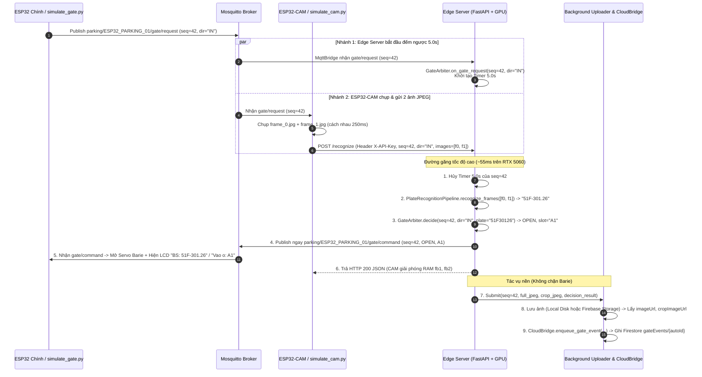

# Kế Hoạch Triển Khai Chi Tiết — Phase S5: Fast Gate Arbiter, Endpoint `/recognize` & Async Storage Uploader

> **Tài liệu tham chiếu gốc:**
> - [`docs/Plan_Repo1_IoT_And_Edge_Backend.md`](file:///f:/CodePJ/IOT-Parking/docs/Plan_Repo1_IoT_And_Edge_Backend.md) (Mục 3.4, 3.5, 4.3, 4.4 và Phase S5)
> - [`docs/Plan_Repo2_Android_And_Cloud_Backend.md`](file:///f:/CodePJ/IOT-Parking/docs/Plan_Repo2_Android_And_Cloud_Backend.md) (Mục 2.1 — Schema `gateEvents`, Mục 3.2 — Cloud Functions `onGateEventCreated`)
> - [`docs/Phase_S4_Implementation_Plan.md`](file:///f:/CodePJ/IOT-Parking/docs/Phase_S4_Implementation_Plan.md) (AI Pipeline đã hoàn thành ở Phase S4)

---

## 1. Mục tiêu của Phase S5

Khép kín **vòng lặp phần cứng — AI — Barie thời gian thực (End-to-End Hardware-in-the-Loop)**:
1. **Ra quyết định cổng siêu tốc (`< 5ms`)** ngay trên RAM (`StateCache`) thông qua bộ phân xử [`GateArbiter`](file:///f:/CodePJ/IOT-Parking/edge-backend/app/arbiter/gate_arbiter.py):
   - Bảo vệ tuyệt đối các ô đã được đặt trước trên App (`activeReservations`).
   - Tự động đối sánh biển số xe vào với danh sách đặt trước để gán đúng ô đỗ (`assignedSlot`) hoặc chuyển sang ô trống dự phòng (`reserved_slot_substituted`) nếu ô đặt trước bị xe khác đỗ đè.
   - Đảm bảo tính **Idempotency** theo `seq` (mỗi lượt xe chỉ ra quyết định và bắn lệnh MQTT đúng 1 lần duy nhất).
2. **Cơ chế chống kẹt cổng 2 tầng (Dual-Timeout Fail-safe):**
   - **Tầng 1 (Edge Server — `5.0s`):** Khi nhận `parking/ESP32_PARKING_01/gate/request` từ ESP32 Chính, `GateArbiter` đặt hẹn giờ `5.0s`. Nếu ESP32-CAM bị treo, mất Wi-Fi hoặc gửi ảnh trễ quá `5.0s`, Edge Server **chủ động** phân xử ngay ở chế độ `unrecognized` (`flags = ["unrecognized", "camera_timeout"]`) và bắn lệnh `OPEN` (kèm ô trống) xuống ESP32 Chính trước khi ESP32 kịp chạm mốc timeout cứng 8 giây.
   - **Tầng 2 (ESP32 Firmware — `8.0s`):** Nếu cả Edge Server hoặc Mosquitto sập nguồn, ESP32 tự mở cổng sau `8.0s` và báo `offlineFallback = true`.
3. **Xây dựng Endpoint `POST /recognize` ([`edge-backend/app/api/recognize.py`](file:///f:/CodePJ/IOT-Parking/edge-backend/app/api/recognize.py)):**
   - Tương thích 100% với gói tin `multipart/form-data` từ firmware [`src/cam/main_cam.cpp`](file:///f:/CodePJ/IOT-Parking/src/cam/main_cam.cpp).
   - **Ưu tiên đường găng (Critical Path):** Nhận ảnh $\rightarrow$ Chạy AI GPU (~50ms) $\rightarrow$ `GateArbiter.decide()` (< 1ms) $\rightarrow$ **Publish ngay `gate/command` qua MQTT** $\rightarrow$ Trả HTTP 200 cho ESP32-CAM. Tổng thời gian từ lúc CAM gửi ảnh đến lúc Barie mở chỉ **~60ms – 150ms**.
4. **Upload ảnh & Ghi `gateEvents` bất đồng bộ ([`edge-backend/app/cloud/storage_uploader.py`](file:///f:/CodePJ/IOT-Parking/edge-backend/app/cloud/storage_uploader.py)):**
   - Đẩy việc lưu ảnh (`full.jpg`, `crop.jpg`) và ghi bản ghi `gateEvents` sang luồng nền (`ThreadPoolExecutor`), tuyệt đối không làm chậm tốc độ mở cổng.
   - Hỗ trợ song song 2 chế độ:
     - `FIREBASE_ENABLED=false`: Lưu ảnh ra đĩa cục bộ tại `edge-backend/data/captures/{yyyy-mm-dd}/` và ghi log đầy đủ qua `NullCloudBridge`.
     - `FIREBASE_ENABLED=true`: Upload lên Firebase Storage và ghi `gateEvents` chuẩn schema Repo 2 lên Cloud Firestore.
5. **Công cụ giả lập ESP32-CAM ([`edge-backend/scripts/simulate_cam.py`](file:///f:/CodePJ/IOT-Parking/edge-backend/scripts/simulate_cam.py)):**
   - Lắng nghe MQTT `gate/request` giống hệt mạch ESP32-CAM thật, tự động bốc ảnh biển số thật từ `yolo_plate_dataset/` gửi `POST /recognize` để test toàn diện luồng `simulate_gate.py` $\leftrightarrow$ `Mosquitto` $\leftrightarrow$ `simulate_cam.py` $\leftrightarrow$ `Edge Server`.

---

## 2. Kiến trúc Luồng Xử Lý Phase S5



---

## 3. Cấu trúc thư mục các file thêm mới / cập nhật trong Phase S5

```text
edge-backend/
├── app/
│   ├── arbiter/
│   │   ├── __init__.py                 # [MỚI] Export GateArbiter, ArbiterDecision
│   │   └── gate_arbiter.py             # [MỚI] Logic phân xử cổng < 5ms + Idempotency + Timer 5.0s
│   ├── cloud/
│   │   ├── base.py                     # [CẬP NHẬT] Mở rộng chữ ký enqueue_gate_event đầy đủ trường Repo 2
│   │   ├── null_bridge.py              # [CẬP NHẬT] Log chi tiết đầy đủ các trường gateEvents
│   │   ├── firestore_bridge.py         # [CẬP NHẬT] Ghi đầy đủ schema gateEvents mục 2.1 Repo 2
│   │   └── storage_uploader.py         # [MỚI] Async Worker lưu ảnh Local / Firebase Storage + đẩy gateEvents
│   ├── api/
│   │   ├── recognize.py                # [MỚI] Endpoint POST /recognize cho ESP32-CAM
│   │   ├── health.py                   # [CẬP NHẬT] Bổ sung trạng thái AI Pipeline & Arbiter vào /health
│   │   └── debug.py                    # [CẬP NHẬT] Thêm POST /debug/simulate-recognize để test nhanh
│   ├── config.py                       # [CẬP NHẬT] Thêm CAMERA_TIMEOUT_S = 5.0, LOCAL_CAPTURE_DIR = "data/captures"
│   ├── models.py                       # [CẬP NHẬT] Thêm model GateEventRecord và RecognizeResponse
│   ├── state_cache.py                  # [CẬP NHẬT] Thêm helper get_active_reservations() phục vụ GateArbiter
│   ├── mqtt/
│   │   └── bridge.py                   # [CẬP NHẬT] Kết nối _handle_gate_request với GateArbiter.on_gate_request()
│   └── main.py                         # [CẬP NHẬT] Khởi tạo GateArbiter, StorageUploader, mount recognize_router, StaticFiles("/captures")
├── scripts/
│   └── simulate_cam.py                 # [MỚI] Giả lập ESP32-CAM lắng nghe MQTT và POST ảnh thật từ dataset
└── tests/
    ├── test_gate_arbiter.py            # [MỚI] Unit test mọi nhánh phân xử cổng, đặt chỗ, đỗ đè, idempotency, timeout 5s
    └── test_recognize_api.py           # [MỚI] Integration test POST /recognize (X-API-Key, multipart, bắn MQTT, lưu ảnh)
```

---

## 4. Thiết kế chi tiết từng Module

### 4.1. Module 1: Bộ Phân Xử Cổng (`app/arbiter/gate_arbiter.py`)

#### A. Cấu trúc dữ liệu kết quả `ArbiterDecision`
```python
@dataclass
class ArbiterDecision:
    seq: int
    direction: str                        # "IN" | "OUT"
    action: str                           # "OPEN" | "DENY"
    status: str                           # "ok" | "unrecognized" | "denied_full" | "denied_reserved_taken" | "duplicate_ignored"
    assigned_slot: str = ""               # "A1" | "A2" | "B1" | "B2" | ""
    matched_reservation_id: Optional[str] = None
    deny_reason: Optional[str] = None     # "FULL" | "RESERVED_SLOT_TAKEN" | None
    flags: List[str] = field(default_factory=list)
    plate_raw: str = ""
    plate_normalized: str = ""
    plate_display: str = ""
    plate_for_lcd: str = ""               # Chuỗi gửi xuống MQTT gate/command.plate (tối đa 12 ký tự cho LCD 1602)
    confidence: float = 0.0
    is_duplicate: bool = False
```

#### B. Quy tắc chọn chuỗi `plate_for_lcd` hiển thị trên màn hình LCD 1602 của ESP32 Chính
- Trong [`src/gate/DisplayManager.cpp`](file:///f:/CodePJ/IOT-Parking/src/gate/DisplayManager.cpp#L170-L185), khi mở cổng, dòng 2 của LCD 1602 hiển thị:
  - Nếu `plate` có nội dung: `BS: %-12s` (tối đa 12 ký tự).
  - Nếu `plate` rỗng `""`: hiển thị số chỗ trống `Tr:X/4 (A:X B:X)`.
- Do đó:
  - Khi nhận diện thành công (`is_valid == True`): truyền `plate_for_lcd = plate_display` (ví dụ `"51F-301.26"` dài 10 ký tự hoặc `"59X1-123.45"` dài 11 ký tự — vừa khít 12 ô của LCD 1602 và rất đẹp!). Nếu vì lý do nào đó `len(plate_display) > 12`, truyền `plate_normalized[:12]`.
  - Khi không nhận diện được (`unrecognized`): truyền `plate_for_lcd = "KHONG RO"` (hoặc `""` nếu muốn giữ thông tin chỗ trống). Ở đây truyền `"KHONG RO"` để người trực bãi/người dùng biết ngay camera không đọc được biển nhưng hệ thống vẫn cấp ô trống bình thường.

#### C. Thuật toán Phân Xử Chi Tiết (`decide()`)

1. **Kiểm tra chống trùng lặp `seq` (Idempotency):**
   - Mỗi `GateArbiter` duy trì một `OrderedDict[int, ArbiterDecision]` (giới hạn 128 `seq` gần nhất) bảo vệ bởi `threading.RLock`.
   - Khi `decide(seq=...)` được gọi (dù từ HTTP `/recognize` hay từ `Timer 5.0s`):
     - Hủy ngay `Timer 5.0s` của `seq` đó (nếu đang đếm).
     - Xóa `seq` khỏi `StateCache._pending_requests`.
     - Nếu `seq > 0` và `seq` **đã có** trong `_processed_seqs`: trả về quyết định cũ với cờ `is_duplicate = True` và **không** bắn lại lệnh MQTT hay ghi trùng `gateEvents`.

2. **Trường hợp Xe Ra (`direction == "OUT"`):**
   - Luôn trả về `action = "OPEN"`, `assigned_slot = ""`, `deny_reason = None`.
   - Nếu `is_valid == True` và `confidence >= settings.OCR_CONF_THRESHOLD`:
     - `status = "ok"`, `flags = []`.
   - Ngược lại (không đọc được biển xe ra):
     - `status = "unrecognized"`, `flags = ["unrecognized", "exit_manual_reconcile"]`.

3. **Trường hợp Xe Vào (`direction == "IN"`):**
   - Trước tiên gọi `cache.purge_expired_reservations()` để dọn sạch các đặt chỗ đã quá hạn `expiresAt <= now`.
   - Lấy bản chụp nguyên tử (atomic) từ `StateCache`:
     - `sensor_occ = cache.get_sensor_occupied()` (`{"A1": bool, "A2": bool, "B1": bool, "B2": bool}`)
     - `active_res = cache.get_active_reservations()` (danh sách `ReservationItem` còn hiệu lực `expiresAt > now`)
     - `reserved_mask = cache.compute_reserved_mask()` (`{"A1": bool, ...}`)
   - **Nhánh 3.1 — Biển số hợp lệ (`is_valid == True`) VÀ khớp với một `ReservationItem` đang active (`res.plate == plate_normalized`):**
     - **TH 3.1a — Ô đã đặt đang trống vật lý (`not sensor_occ[res.slotId]`):**
       - `action = "OPEN"`
       - `assigned_slot = res.slotId`
       - `matched_reservation_id = res.id`
       - `status = "ok"`
       - `flags = ["matched_reservation"]`
     - **TH 3.1b — Ô đã đặt bị xe khác đỗ đè vật lý (`sensor_occ[res.slotId] == True`):**
       - Quét tìm ô dự phòng đầu tiên theo thứ tự `A1 -> A2 -> B1 -> B2` thỏa mãn `not sensor_occ[s] and not reserved_mask[s]`:
         - Nếu tìm thấy ô `alt_slot`:
           - `action = "OPEN"`
           - `assigned_slot = alt_slot`
           - `matched_reservation_id = res.id`
           - `status = "ok"`
           - `flags = ["matched_reservation", "reserved_slot_substituted"]`
         - Nếu không còn bất kỳ ô trống nào:
           - `action = "DENY"`
           - `assigned_slot = ""`
           - `matched_reservation_id = res.id`
           - `deny_reason = "RESERVED_SLOT_TAKEN"`
           - `status = "denied_reserved_taken"`
           - `flags = ["reserved_slot_occupied_and_lot_full"]`
   - **Nhánh 3.2 — Khách vãng lai (Biển số hợp lệ nhưng không có reservation) HOẶC Không nhận diện được biển số (`unrecognized`):**
     - Quét tìm ô đầu tiên theo thứ tự `A1 -> A2 -> B1 -> B2` thỏa mãn **cả 2 điều kiện**:
       - `not sensor_occ[s]` (vật lý đang trống)
       - `not reserved_mask[s]` (không bị khóa bởi đặt chỗ của người khác)
     - **TH 3.2a — Tìm thấy ô trống `free_slot`:**
       - `action = "OPEN"`
       - `assigned_slot = free_slot`
       - Nếu đọc được biển hợp lệ (`is_valid == True`):
         - `status = "ok"`, `flags = []`
       - Nếu không đọc được biển (`not is_valid`):
         - `status = "unrecognized"`, `flags = ["unrecognized"]` (nếu do timeout 5.0s thì thêm `"camera_timeout"`).
     - **TH 3.2b — Không còn ô trống khả dụng (`free_slot is None`):**
       - `action = "DENY"`
       - `assigned_slot = ""`
       - `deny_reason = "FULL"`
       - `status = "denied_full"`
       - `flags = ["lot_full"]` (kèm `"unrecognized"` nếu không đọc được biển).

#### D. Cơ chế Hẹn giờ 5.0 giây (`on_gate_request` & `_on_camera_timeout`)
- Khi [`MqttBridge._handle_gate_request`](file:///f:/CodePJ/IOT-Parking/edge-backend/app/mqtt/bridge.py#L170-L200) nhận gói tin `gate/request(seq, direction, offlineFallback=False)`:
  - Gọi `arbiter.on_gate_request(seq, direction)`.
  - `GateArbiter` lưu `seq` vào `StateCache` và khởi tạo `threading.Timer(settings.CAMERA_TIMEOUT_S, self._on_camera_timeout, args=(seq, direction))`.
- Nếu sau `5.0s` (cấu hình qua `settings.CAMERA_TIMEOUT_S = 5.0`), ESP32-CAM chưa gọi `/recognize` cho `seq` này:
  - `_on_camera_timeout(seq, direction)` tự động chạy:
    1. Gọi `self.decide(seq=seq, direction=direction, pipeline_result=None, extra_flags=["camera_timeout"])`.
    2. Bắn lệnh MQTT `gate/command` ngay lập tức thông qua `mqtt_bridge.publish_gate_command(...)`.
    3. Đẩy bản ghi `gateEvents` (không có ảnh, `status="unrecognized"`, `flags=["unrecognized", "camera_timeout"]`) lên `CloudBridge`.

---

### 4.2. Module 2: Async Storage Uploader (`app/cloud/storage_uploader.py`) & Nâng cấp `CloudBridge`

#### A. Mở rộng `CloudBridgeBase.enqueue_gate_event`
Cập nhật chữ ký hàm trong [`app/cloud/base.py`](file:///f:/CodePJ/IOT-Parking/edge-backend/app/cloud/base.py), [`app/cloud/null_bridge.py`](file:///f:/CodePJ/IOT-Parking/edge-backend/app/cloud/null_bridge.py) và [`app/cloud/firestore_bridge.py`](file:///f:/CodePJ/IOT-Parking/edge-backend/app/cloud/firestore_bridge.py) để hỗ trợ đầy đủ 100% các trường trong schema `gateEvents` (Mục 2.1 của [`docs/Plan_Repo2_Android_And_Cloud_Backend.md`](file:///f:/CodePJ/IOT-Parking/docs/Plan_Repo2_Android_And_Cloud_Backend.md)):
```python
def enqueue_gate_event(
    self,
    seq: int,
    direction: str,
    decision: str,
    status: str,
    flags: List[str],
    plate_raw: str = "",
    plate_norm: str = "",
    plate_display: str = "",
    confidence: float = 0.0,
    assigned_slot_id: Optional[str] = None,
    matched_reservation_id: Optional[str] = None,
    deny_reason: Optional[str] = None,
    image_url: Optional[str] = None,
    crop_image_url: Optional[str] = None,
    latency_ms: float = 0.0,
) -> None:
```
Khi `FirestoreBridge._commit_batch` ghi lên collection `gateEvents/{autoId}`, document sẽ có cấu trúc khớp tuyệt đối với Cloud Functions `onGateEventCreated` của Repo 2:
```json
{
  "deviceId": "ESP32_PARKING_01",
  "lotId": "lot_live_01",
  "seq": 42,
  "direction": "IN",
  "plateRaw": "51F-301.26",
  "plateNormalized": "51F30126",
  "plateDisplay": "51F-301.26",
  "confidence": 0.912,
  "decision": "OPEN",
  "denyReason": null,
  "assignedSlotId": "A1",
  "matchedReservationId": null,
  "flags": [],
  "status": "ok",
  "imageUrl": "/captures/2026-11-10/seq42_IN_full.jpg",
  "cropImageUrl": "/captures/2026-11-10/seq42_IN_crop.jpg",
  "latencyMs": 51.4,
  "source": "edge",
  "serverTs": "<SERVER_TIMESTAMP>"
}
```

#### B. Thiết kế `StorageUploader` (`app/cloud/storage_uploader.py`)
- Sử dụng `concurrent.futures.ThreadPoolExecutor(max_workers=2, thread_name_prefix="storage_uploader")`.
- Phương thức `submit_capture_and_event(decision: ArbiterDecision, full_jpeg_bytes: Optional[bytes], crop_jpeg_bytes: Optional[bytes], latency_ms: float)`:
  1. Đưa tác vụ vào `ThreadPoolExecutor` và trả về ngay lập tức (`< 0.1ms`).
  2. Trong worker thread:
     - **Lưu file локально (Luôn lưu để phục vụ debug và đối soát tại Edge):**
       - Lưu vào `edge-backend/data/captures/{YYYY-MM-DD}/seq{seq}_{direction}_{timestamp}_full.jpg` và `_crop.jpg`.
       - Đường dẫn tĩnh qua FastAPI: `/captures/{YYYY-MM-DD}/...`
     - **Nếu `settings.FIREBASE_ENABLED == True` và `settings.FIREBASE_STORAGE_BUCKET` có cấu hình:**
       - Upload `full_jpeg_bytes` và `crop_jpeg_bytes` lên Firebase Cloud Storage tại `gate/{YYYY-MM-DD}/seq{seq}_{direction}_{timestamp}_full.jpg`.
       - Lấy public/signed URL (hoặc `gs://` URL) gán vào `image_url`, `crop_image_url`.
     - **Gọi `cloud_bridge.enqueue_gate_event(...)`** với đầy đủ URL ảnh và kết quả từ `ArbiterDecision`.

---

### 4.3. Module 3: Endpoint `POST /recognize` (`app/api/recognize.py`)

- **Route:** `POST /recognize`
- **Xác thực bảo mật:**
  - Kiểm tra Header `X-API-Key`.
  - Nếu thiếu hoặc khác `settings.CAM_SHARED_API_KEY`: trả về `HTTP 401 Unauthorized` (`{"detail": "Invalid or missing X-API-Key"}`).
- **Tham số đầu vào (`multipart/form-data`):**
  - `device_id: str = Form("ESP32_CAM_01")`
  - `seq: int = Form(...)`
  - `direction: str = Form(...)` (`"IN"` hoặc `"OUT"`, tự động `.upper()`)
  - `images: List[UploadFile] = File(...)` (1 hoặc 2 file JPEG từ ESP32-CAM)
- **Các bước xử lý trong Request Handler:**
  1. Validate `direction` thuộc `{"IN", "OUT"}` (nếu sai trả `HTTP 422`).
  2. Đọc bytes của tất cả các file trong `images`: `frames_bytes = [await f.read() for f in images if f.size and f.size > 0]`. Nếu không có frame hợp lệ nào, vẫn cho phép gọi `GateArbiter` ở chế độ `unrecognized` thay vì làm treo cổng!
  3. Chạy nhận diện trên GPU: `pipeline_res = ai_pipeline.recognize_frames(frames_bytes)`.
  4. Phân xử quyết định mở cổng: `decision = arbiter.decide_from_recognition(seq=seq, direction=direction, pipeline_result=pipeline_res)`.
  5. Nếu `not decision.is_duplicate`:
     - **Gọi ngay** `mqtt_bridge.publish_gate_command(seq=seq, action=decision.action, plate=decision.plate_for_lcd, assigned_slot=decision.assigned_slot, reason=decision.deny_reason)`.
     - Chọn frame gốc tốt nhất: `best_full_jpeg = frames_bytes[pipeline_res.best_frame_index]` (nếu có).
     - Đẩy tác vụ lưu ảnh + ghi `gateEvents` vào nền: `storage_uploader.submit_capture_and_event(decision, best_full_jpeg, pipeline_res.crop_jpeg_bytes, pipeline_res.latency_ms)`.
  6. Trả về HTTP 200 JSON cho ESP32-CAM:
     ```json
     {
       "ok": true,
       "seq": 42,
       "direction": "IN",
       "action": "OPEN",
       "status": "ok",
       "assignedSlot": "A1",
       "plateRaw": "51F-301.26",
       "plateNormalized": "51F30126",
       "plateDisplay": "51F-301.26",
       "confidence": 0.912,
       "latencyMs": 51.4,
       "duplicate": false
     }
     ```

---

### 4.4. Module 4: Công cụ Giả lập ESP32-CAM (`edge-backend/scripts/simulate_cam.py`)

Để kiểm thử trọn vẹn sự phối hợp giữa **ESP32 Chính $\leftrightarrow$ Mosquitto $\leftrightarrow$ ESP32-CAM $\leftrightarrow$ Edge Server** ngay trên máy tính:
- Script `simulate_cam.py` đóng vai trò **bản sao 1:1 của `src/cam/main_cam.cpp`**:
  1. Kết nối vào Mosquitto Broker với tài khoản `cam_01` / `cam_secret_2026`, đăng ký LWT `parking/ESP32_CAM_01/status` = `"online"`.
  2. Subscribe topic `parking/ESP32_PARKING_01/gate/request`.
  3. Khi nhận được `gate/request(seq, direction)` (mà `offlineFallback` không bật):
     - Chờ giả lập 150ms (như thời gian chụp 2 frame trên CAM thật).
     - Lấy 2 ảnh từ `f:\CodePJ\IOT-Parking\yolo_plate_dataset\images\val` (hoặc ảnh do người dùng chỉ định qua tham số `--image` / chế độ `--unrecognized` gửi ảnh trắng).
     - Gửi `POST http://127.0.0.1:8000/recognize` kèm header `X-API-Key: smart-parking-cam-secret-2026` và `multipart/form-data` (`device_id`, `seq`, `direction`, `images=[frame_0.jpg, frame_1.jpg]`).
     - In kết quả phản hồi từ Edge Server ra màn hình console.

---

## 5. Kế hoạch Kiểm thử & Nghiệm thu Phase S5 (`tests/test_gate_arbiter.py` & `tests/test_recognize_api.py`)

Toàn bộ các kịch bản dưới đây sẽ được tự động hóa bằng `pytest` (và có thể chạy demo trực quan qua `simulate_gate.py` + `simulate_cam.py`):

| Mã Test | Kịch bản kiểm thử | Trạng thái đầu vào (`StateCache`) | Kết quả kỳ vọng |
| :--- | :--- | :--- | :--- |
| **S5-T1** | Khách vãng lai vào bãi trống | 4 ô trống, 0 đặt chỗ, ảnh biển `61F-222.61` | `OPEN`, `assignedSlot="A1"`, `plate="61F-222.61"`, `status="ok"` |
| **S5-T2** | Bảo vệ ô đã đặt trước (ST-03) | `A1` đã được đặt bởi `51A11111`, khách vãng lai `61F22261` đi vào | **Bỏ qua `A1`**, cấp `assignedSlot="A2"`, `OPEN` |
| **S5-T3** | Chủ xe có đặt trước đến đúng giờ | `B1` được đặt bởi `61F22261` (`res_01`), xe `61F-222.61` đi vào | `OPEN`, **gán đúng `assignedSlot="B1"`**, `matchedReservationId="res_01"` |
| **S5-T4** | Ô đặt trước bị đỗ đè, còn ô trống khác | `B1` đặt bởi `61F22261` nhưng `sensorOccupied["B1"]=True`; `A1` đang trống | `OPEN`, chuyển sang `assignedSlot="A1"`, `flags` có `"reserved_slot_substituted"` |
| **S5-T5** | Ô đặt trước bị đỗ đè, bãi đã hết sạch chỗ | `B1` đặt bởi `61F22261` nhưng cả 4 ô đều `occupied/reserved` | `DENY`, `reason="RESERVED_SLOT_TAKEN"`, `status="denied_reserved_taken"` |
| **S5-T6** | Bãi đầy hoàn toàn (Vật lý + Đặt chỗ) | `A1, A2` có xe đỗ (`occupied=True`); `B1, B2` đã được đặt trước (`reserved=True`) | Khách vãng lai vào $\rightarrow$ `DENY`, `reason="FULL"`, `status="denied_full"` |
| **S5-T7** | Không đọc được biển số (`unrecognized`) khi bãi còn chỗ | Ảnh mờ/trắng, bãi còn trống ô `B2` | **Không chặn xe:** `OPEN`, `assignedSlot="B2"`, `status="unrecognized"`, `flags=["unrecognized"]` |
| **S5-T8** | Xe đi ra (`direction="OUT"`) | Bất kỳ trạng thái bãi (đọc được biển hoặc không đọc được biển) | Luôn `OPEN`, `assignedSlot=""` (nếu mờ biển thì gắn cờ `"exit_manual_reconcile"`) |
| **S5-T9** | ESP32-CAM mất kết nối / Timeout 5.0s (ST-04) | Nhận MQTT `gate/request(seq=99, dir="IN")`, không có HTTP POST nào tới | Sau `CAMERA_TIMEOUT_S`, tự động bắn MQTT `OPEN` kèm ô trống, `flags=["unrecognized", "camera_timeout"]` |
| **S5-T10** | Chống xử lý trùng `seq` (Idempotency) & Bảo mật API Key | Gửi 2 lần `POST /recognize` cùng `seq=50` hoặc gửi sai `X-API-Key` | Lần 2 trả `duplicate=True` và không bắn lại MQTT; sai API Key trả `HTTP 401` |

---

## 6. Trình tự thực hiện (Sau khi bạn duyệt Plan)

1. **Bước 1:** Cập nhật [`app/config.py`](file:///f:/CodePJ/IOT-Parking/edge-backend/app/config.py), [`app/models.py`](file:///f:/CodePJ/IOT-Parking/edge-backend/app/models.py), [`app/state_cache.py`](file:///f:/CodePJ/IOT-Parking/edge-backend/app/state_cache.py) (thêm `CAMERA_TIMEOUT_S`, `LOCAL_CAPTURE_DIR`, `get_active_reservations()`).
2. **Bước 2:** Xây dựng [`app/arbiter/gate_arbiter.py`](file:///f:/CodePJ/IOT-Parking/edge-backend/app/arbiter/gate_arbiter.py) và tích hợp vào [`app/mqtt/bridge.py`](file:///f:/CodePJ/IOT-Parking/edge-backend/app/mqtt/bridge.py).
3. **Bước 3:** Nâng cấp [`app/cloud/base.py`](file:///f:/CodePJ/IOT-Parking/edge-backend/app/cloud/base.py), [`app/cloud/null_bridge.py`](file:///f:/CodePJ/IOT-Parking/edge-backend/app/cloud/null_bridge.py), [`app/cloud/firestore_bridge.py`](file:///f:/CodePJ/IOT-Parking/edge-backend/app/cloud/firestore_bridge.py) và viết [`app/cloud/storage_uploader.py`](file:///f:/CodePJ/IOT-Parking/edge-backend/app/cloud/storage_uploader.py).
4. **Bước 4:** Xây dựng [`app/api/recognize.py`](file:///f:/CodePJ/IOT-Parking/edge-backend/app/api/recognize.py), cập nhật [`app/api/health.py`](file:///f:/CodePJ/IOT-Parking/edge-backend/app/api/health.py), [`app/api/debug.py`](file:///f:/CodePJ/IOT-Parking/edge-backend/app/api/debug.py) và [`app/main.py`](file:///f:/CodePJ/IOT-Parking/edge-backend/app/main.py).
5. **Bước 5:** Viết [`scripts/simulate_cam.py`](file:///f:/CodePJ/IOT-Parking/edge-backend/scripts/simulate_cam.py), bộ test [`tests/test_gate_arbiter.py`](file:///f:/CodePJ/IOT-Parking/edge-backend/tests/test_gate_arbiter.py) & [`tests/test_recognize_api.py`](file:///f:/CodePJ/IOT-Parking/edge-backend/tests/test_recognize_api.py), chạy `pytest` kiểm tra toàn bộ hệ thống và cập nhật tiến độ vào tài liệu tổng.

