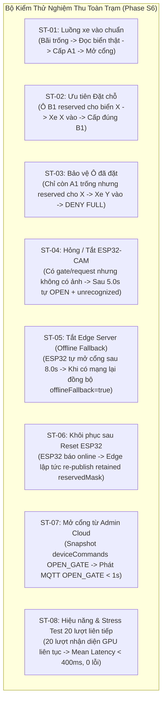

# Kế Hoạch Triển Khai Chi Tiết — Phase S6: Kiểm Thử Tích Hợp Toàn Trạm & Nghiệm Thu (`ST-01` → `ST-08`)

> **Tài liệu tham chiếu gốc:**
> - [`docs/Plan_Repo1_IoT_And_Edge_Backend.md`](file:///f:/CodePJ/IOT-Parking/docs/Plan_Repo1_IoT_And_Edge_Backend.md) (Phase S6 — Bộ Test Case Kiểm Thử Repo 1 `ST-01` → `ST-08`)
> - [`docs/Repo1_Execution_Plan.md`](file:///f:/CodePJ/IOT-Parking/docs/Repo1_Execution_Plan.md) (Phase S6)
> - [`docs/Phase_S5_Implementation_Plan.md`](file:///f:/CodePJ/IOT-Parking/docs/Phase_S5_Implementation_Plan.md) (Đã hoàn thành 71/71 unit & integration tests)

---

## 1. Mục tiêu của Phase S6

Phase S6 là chặng cuối cùng để **đóng gói và nghiệm thu 100% Repo 1 (`iot-parking-station`)**, đảm bảo toàn bộ chuỗi **Firmware ESP32 Chính + Firmware ESP32-CAM + Mosquitto Broker + Edge Backend (FastAPI + GPU AI Pipeline + GateArbiter + CloudBridge)** phối hợp trơn tru, chịu lỗi tốt và đạt mọi chỉ tiêu kỹ thuật trước khi kết nối với Repo 2 (Android App & Cloud Functions):

1. **Xác nhận biên dịch sạch (Zero-Error Build) cho cả 2 Firmware:**
   - Môi trường `[env:nodemcu-32s]` (ESP32 Chính: `ParkingMonitor`, `GateController`, `DisplayManager`, `ParkingNetworkClient`).
   - Môi trường `[env:esp32cam]` (ESP32-CAM AI-Thinker: `main_cam.cpp`).
2. **Tự động hóa 100% 8 kịch bản kiểm thử toàn trạm (`ST-01` → `ST-08`)** bằng cả:
   - **Pytest System Integration Suite ([`edge-backend/tests/test_system_integration_s6.py`](file:///f:/CodePJ/IOT-Parking/edge-backend/tests/test_system_integration_s6.py)):** Chạy trực tiếp với mô hình YOLOv8 + EasyOCR thật trên GPU RTX 5060 và ảnh biển số thật từ `yolo_plate_dataset/`, kiểm tra toàn diện từ gói tin MQTT `gate/request` $\rightarrow$ `POST /recognize` $\rightarrow$ `gate/command` $\rightarrow$ `StorageUploader` $\rightarrow$ `CloudBridge` (`gateEvents`).
   - **Script Nghiệm Thu & Stress Test Toàn Trạm ([`edge-backend/scripts/run_s6_verification.py`](file:///f:/CodePJ/IOT-Parking/edge-backend/scripts/run_s6_verification.py)):** Thực thi liên hoàn 8 kịch bản `ST-01` → `ST-08` (bao gồm bài đo tải 20 lượt nhận diện liên tiếp ở `ST-08`), in bảng tổng kết Pass/Fail và thống kê độ trễ (`Mean`, `P95`, `Max Latency`) ngay trên console.
3. **Sổ tay Vận hành & Đấu nối Trạm Vật Lý ([`docs/Station_Runbook.md`](file:///f:/CodePJ/IOT-Parking/docs/Station_Runbook.md)):**
   - Hướng dẫn từng bước từ lúc bật Mosquitto, khởi động Edge Server, nạp code ESP32/ESP32-CAM đến cách chạy giả lập toàn phần khi chưa cắm mạch.

---

## 2. Ma Trận Ánh Xạ 8 Kịch Bản Kiểm Thử (`ST-01` → `ST-08`)



### Chi tiết từng kịch bản nghiệm thu trong Phase S6:

| Mã TC | Tên kịch bản | Luồng thực thi chi tiết | Tiêu chí Nghiệm thu (Pass Criteria) |
| :---: | :--- | :--- | :--- |
| **ST-01** | **Luồng vào chuẩn** | 1. Bãi trống cả 4 ô (`A1, A2, B1, B2`).<br/>2. ESP32 gửi MQTT `gate/request` (`seq=1, dir="IN"`).<br/>3. CAM gửi `POST /recognize` kèm ảnh biển số thật từ `yolo_plate_dataset` (`CarLongPlate10.jpg` — biển `61F-222.61`). | - AI đọc đúng `plateNormalized="61F22261"`, `plateDisplay="61F-222.61"`.<br/>- MQTT phát `gate/command`: `action="OPEN"`, `assignedSlot="A1"`, `plate="61F-222.61"`.<br/>- Ảnh `_full.jpg` và `_crop.jpg` được lưu vào `data/captures/`.<br/>- `gateEvents` được ghi với `status="ok"`, `assignedSlotId="A1"`. |
| **ST-02** | **Ưu tiên Đặt chỗ** | 1. Ô `A1, A2` đang trống vật lý; ô `B1` đang có `activeReservation` (`id="res_st02"`) cho biển `61F22261`.<br/>2. Xe biển `61F-222.61` vào cổng (`seq=2, dir="IN"`). | - Dù `A1, A2` trống nhưng `GateArbiter` **gán đúng `assignedSlot="B1"`**.<br/>- `gateEvents` ghi nhận `matchedReservationId="res_st02"`, `flags=["matched_reservation"]`. |
| **ST-03** | **Bảo vệ Ô đã đặt** | 1. Ô `A2, B1, B2` đang có xe đỗ (`occupied=True`).<br/>2. Ô `A1` trống vật lý (`occupied=False`) nhưng đang `reserved` cho biển `51A99999`.<br/>3. Xe vãng lai `61F-222.61` tới cổng (`seq=3, dir="IN"`). | - `StateCache.free_slots_public()` báo `0` chỗ trống.<br/>- `GateArbiter` trả `action="DENY"`, `denyReason="FULL"`, `assignedSlot=""`.<br/>- MQTT phát `gate/command` với `action="DENY"`, `reason="FULL"`.<br/>- Ô `A1` được bảo vệ nguyên vẹn cho người đặt trước. |
| **ST-04** | **Hỏng / Tắt ESP32-CAM** | 1. Bãi còn chỗ trống (`A1`).<br/>2. ESP32 gửi MQTT `gate/request` (`seq=4, dir="IN"`).<br/>3. ESP32-CAM bị rút nguồn (không có request `POST /recognize` nào gửi lên). | - Đúng sau `CAMERA_TIMEOUT_S` (5.0s trên cấu hình chuẩn), `GateArbiter` tự động kích hoạt `_on_camera_timeout`.<br/>- MQTT phát `gate/command`: `action="OPEN"`, `assignedSlot="A1"`, `plate="KHONG RO"`.<br/>- `gateEvents` được ghi với `status="unrecognized"`, `flags=["unrecognized", "camera_timeout"]`. |
| **ST-05** | **Tắt Edge Server (Offline Fallback)** | 1. Khi mất kết nối Edge Server quá 8.0s, ESP32 tự mở barie cục bộ và lưu sự kiện vào hàng đợi RAM.<br/>2. Khi kết nối lại, ESP32 xả gói tin `gate/request` với `offlineFallback=True, seq=5, dir="IN"`. | - `MqttBridge._handle_gate_request` nhận diện cờ `offlineFallback=True`.<br/>- Không khởi tạo timer chờ ảnh, mà lập tức đẩy vào `CloudBridge.enqueue_gate_event` với `decision="OPEN"`, `status="offline_fallback"`, `flags=["offline_fallback"]`. |
| **ST-06** | **Khôi phục sau Reset ESP32** | 1. Đang có đặt chỗ tại ô `B2` (`reservedMask = {"A1": False, "A2": False, "B1": False, "B2": True}`).<br/>2. ESP32 chính bị nhấn nút Reset cứng, sau đó kết nối lại và phát LWT `parking/ESP32_PARKING_01/status = "online"`. | - `MqttBridge._handle_device_status("gate", b"online")` lập tức gọi `publish_reserved(current_mask, force=True)` với `retain=True`.<br/>- ESP32 vừa khởi động lại nhận ngay mặt nạ `reserved` mới nhất, trừ đúng số chỗ trống trên LCD/OLED. |
| **ST-07** | **Mở cổng khẩn cấp từ Admin** | 1. Admin trên App/Web tạo document trong `deviceCommands` với `action="OPEN_GATE"`, `status="pending"`, `createdAt=now`.<br/>2. (Đồng thời kiểm tra trường hợp lệnh cũ quá hạn `TTL > 60s`). | - Với lệnh hợp lệ (`age <= 60s`): `FirestoreBridge._on_commands_snapshot` đổi trạng thái sang `status="sent"` và phát ngay MQTT `gate/command` (`seq=0, action="OPEN", plate="ADMIN_OPEN"`).<br/>- Với lệnh quá hạn (`age > 60s`): tự động đánh dấu `status="failed"`, `failReason="EXPIRED"` và **không** mở cổng. |
| **ST-08** | **Hiệu năng & Stress Test 20 lượt liên tiếp** | 1. Gửi liên tiếp 20 lượt xe vào/ra (`seq=101..120`) với ảnh thật từ `yolo_plate_dataset/` qua `POST /recognize`.<br/>2. Đo thời gian xử lý từng lượt trên GPU RTX 5060. | - 20/20 lượt hoàn thành 100% không lỗi.<br/>- Độ trễ trung bình (`Mean Latency`) **< 400ms/lượt** (thực tế trên RTX 5060 đạt ~50–60ms/lượt).<br/>- Toàn bộ 20 lệnh MQTT và 20 bản ghi `gateEvents` được xử lý chính xác, không rò rỉ timer hay nghẽn luồng. |

---

## 3. Cấu trúc các file thêm mới / cập nhật trong Phase S6

```text
f:\CodePJ\IOT-Parking\
├── docs/
│   ├── Phase_S6_Implementation_Plan.md             # [MỚI] Bản kế hoạch chi tiết Phase S6
│   ├── Station_Runbook.md                          # [MỚI] Sổ tay vận hành, đấu nối & chạy demo toàn trạm
│   ├── Repo1_Execution_Plan.md                     # [CẬP NHẬT] Đánh dấu hoàn thành 100% Phase S1 -> S6
│   └── Plan_Repo1_IoT_And_Edge_Backend.md          # [CẬP NHẬT] Đánh dấu hoàn thành Phase S6
└── edge-backend/
    ├── scripts/
    │   └── run_s6_verification.py                  # [MỚI] Script chạy nghiệm thu ST-01 -> ST-08 + Báo cáo Latency 20 lượt
    └── tests/
        └── test_system_integration_s6.py           # [MỚI] Pytest Suite kiểm thử tích hợp toàn trạm ST-01 -> ST-08
```

---

## 4. Trình tự thực hiện (Sau khi bạn duyệt Plan)

1. **Bước 1 — Kiểm tra biên dịch Firmware (`nodemcu-32s` & `esp32cam`):**
   - Kiểm tra công cụ PlatformIO CLI (`pio run -e nodemcu-32s` và `pio run -e esp32cam`) hoặc rà soát tĩnh toàn bộ mã nguồn C++ trong `src/gate/`, `src/cam/`, `include/` để đảm bảo không có bất kỳ xung đột header hay cú pháp nào.
2. **Bước 2 — Xây dựng Pytest Suite Tích Hợp Toàn Trạm ([`edge-backend/tests/test_system_integration_s6.py`](file:///f:/CodePJ/IOT-Parking/edge-backend/tests/test_system_integration_s6.py)):**
   - Viết 8 bài test tích hợp tự động tương ứng 1:1 với `ST-01` → `ST-08`, sử dụng `PlateRecognitionPipeline` thật trên GPU RTX 5060 cho các bài nhận diện biển số.
3. **Bước 3 — Xây dựng Script Nghiệm Thu & Benchmark `ST-01` → `ST-08` ([`edge-backend/scripts/run_s6_verification.py`](file:///f:/CodePJ/IOT-Parking/edge-backend/scripts/run_s6_verification.py)):**
   - Chạy tự động toàn bộ 8 kịch bản, đo đạc thông số thời gian thực của 20 lượt nhận diện liên tiếp (`ST-08`) và xuất bảng kết quả nghiệm thu rõ ràng.
4. **Bước 4 — Biên soạn Sổ Tay Vận Hành Trạm ([`docs/Station_Runbook.md`](file:///f:/CodePJ/IOT-Parking/docs/Station_Runbook.md)) & Cập nhật tài liệu tổng:**
   - Tổng hợp hướng dẫn khởi chạy hệ thống (Docker Mosquitto, FastAPI Edge Server, Simulator Gate/Cam, nạp mạch ESP32) và đánh dấu hoàn tất 100% Repo 1.

