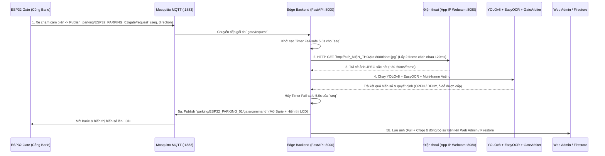

# Kế hoạch Triển khai: Sử dụng Camera Điện Thoại (IP Webcam) thay thế ESP32-CAM

## 1. Mục tiêu
Thay thế (hoặc chạy song song với) module **ESP32-CAM** bằng **Camera của điện thoại thông minh** thông qua ứng dụng **IP Webcam** trong cùng mạng Wi-Fi LAN, nhằm:
- Tận dụng khả năng **Auto-Focus (tự động lấy nét cận cảnh)** và độ phân giải sắc nét của điện thoại khi chụp mô hình biển số nhỏ.
- **Tự động hóa 100%:** Khi xe đi qua cảm biến hồng ngoại ở cổng (`ESP32 Gate`), hệ thống tự động kéo ảnh từ điện thoại, chạy **YOLOv8 + EasyOCR**, ra quyết định đóng/mở barie (`GateArbiter`), hiển thị biển số lên màn hình LCD 1602 và đồng bộ lên Web Admin / Firebase mà **không cần chạm tay vào điện thoại** và **không cần sửa code của mạch ESP32 Gate**.

---

## 2. Kiến trúc & Luồng hoạt động Tự động (End-to-End Flow)

> **Cơ chế an toàn (Fail-safe):** Bộ đếm `5.0 giây` của `GateArbiter` vẫn hoạt động song song. Nếu điện thoại bất ngờ tắt màn hình, thoát ứng dụng hoặc mất kết nối Wi-Fi, sau 5 giây cổng vẫn tự động xử lý theo chế độ `unrecognized` (`camera_timeout`) mà không làm treo cổng.

---

## 3. Chi tiết các Hạng mục Triển khai trong Code

### Hạng mục 1: Cấu hình Nguồn Camera (`edge-backend/app/config.py`)
Bổ sung các thiết lập trong `Settings` (có thể cấu hình qua `.env` hoặc thay đổi nóng ngay trên giao diện Web `/cam-test` mà không cần khởi động lại Server):
- `CAM_SOURCE: str = "phone"` (`"phone"` hoặc `"esp32cam"`).
- `PHONE_CAM_URL: str = ""` (Ví dụ: `http://192.168.1.15:8080/shot.jpg`).
  - Hệ thống tự động chuẩn hóa URL: Người dùng chỉ cần nhập `192.168.1.15:8080` hoặc `http://192.168.1.15:8080`, backend sẽ tự động chuyển thành `http://192.168.1.15:8080/shot.jpg`.
- `PHONE_CAM_FRAMES: int = 2` (Số khung hình chụp liên tiếp mỗi lượt xe qua cổng để áp dụng Multi-frame Voting).
- `PHONE_CAM_INTERVAL_MS: int = 120` (Khoảng cách thời gian giữa 2 lần lấy frame).

---

### Hạng mục 2: Module Thu thập Ảnh & Xử lý Tự động khi Xe qua Cổng (`edge-backend/app/mqtt/bridge.py` & `app/main.py`)
1. **Liên kết thành phần trong `app/main.py`:**
   - Gắn thêm tham chiếu `ai_pipeline` và `storage_uploader` vào đối tượng `mqtt_bridge` khi khởi tạo server.
2. **Hàm kéo ảnh từ điện thoại (`fetch_phone_cam_frames`):**
   - Gửi HTTP GET tới `PHONE_CAM_URL` với timeout ngắn (`2.5s`) để lấy `1..2` frame JPEG từ điện thoại.
3. **Tự động kích hoạt trong `MqttBridge._handle_gate_request()`:**
   - Ngay khi nhận gói tin MQTT `parking/ESP32_PARKING_01/gate/request` (`offlineFallback == false`):
     - Bước 1: Gọi `self.arbiter.on_gate_request(seq, direction)` để kích hoạt bộ đếm bảo hiểm 5.0s.
     - Bước 2: Nếu `CAM_SOURCE == "phone"` và đã có `PHONE_CAM_URL`, khởi chạy một luồng nền (`threading.Thread(daemon=True)`) thực hiện:
       1. Tải 2 frame ảnh từ điện thoại qua `PHONE_CAM_URL`.
       2. Đưa danh sách ảnh vào `self.ai_pipeline.recognize_frames(frames_bytes)`.
       3. Gọi `self.arbiter.decide(...)` để phân xử mở cổng, chọn ô đỗ và tự động hủy bộ đếm 5.0s.
       4. Nếu không phải gói tin trùng (`not decision.is_duplicate`):
          - Gọi `self.publish_gate_command(...)` để mở barie và hiển thị biển số lên màn hình LCD của ESP32 Gate.
          - Gọi `self.storage_uploader.submit_capture_and_event(...)` để lưu ảnh gốc, ảnh crop biển số và đẩy sự kiện lên Firestore / Web Admin Dashboard.

---

### Hạng mục 3: Nâng cấp API & Giao diện Web Kiểm thử (`edge-backend/app/api/debug.py` & `static/cam-test.html`)
1. **Thêm các Endpoint trong `app/api/debug.py`:**
   - `GET /debug/cam-status`: Trả về thêm `camSource` (`"phone"` | `"esp32cam"`), `phoneCamUrl`, và trạng thái kết nối tới điện thoại.
   - `POST /debug/phone-cam-config`: Cập nhật nóng `CAM_SOURCE` và `PHONE_CAM_URL` ngay trong RAM của Server.
   - `POST /debug/phone-cam-test`: Kéo trực tiếp 1 ảnh từ `PHONE_CAM_URL`, chạy qua `YOLOv8 + EasyOCR`, vẽ khung Bounding Box và trả về ảnh gốc + ảnh crop dạng Base64 cho giao diện Web.
2. **Nâng cấp giao diện `http://localhost:8000/cam-test` (`static/cam-test.html`):**
   - Thêm bảng điều khiển **Cấu hình Camera Điện Thoại (IP Webcam)**:
     - Ô nhập địa chỉ IP điện thoại (ví dụ: `192.168.1.15:8080`).
     - Nút chọn chế độ hoạt động khi xe qua cổng: **📱 Dùng Cam Điện Thoại** hoặc **📷 Dùng ESP32-CAM**.
     - Nút **"💾 Lưu cấu hình"**.
     - Nút **"📱 Chụp thử từ Điện thoại"** để căn chỉnh góc đặt điện thoại và kiểm tra ngay kết quả nhận diện của YOLO + EasyOCR trên Web.

---

## 4. Hướng dẫn Chuẩn bị trên Điện thoại
1. **Cài đặt ứng dụng:**
   - **Android:** Tải ứng dụng miễn phí **IP Webcam** (tác giả *Pavel Khlebovich*) trên Google Play Store.
   - **iOS (iPhone):** Tải ứng dụng **IPCamera - High-End NetworkCam** (hoặc ứng dụng hỗ trợ chụp HTTP snapshot tương đương).
2. **Kết nối mạng:**
   - Đảm bảo điện thoại và máy tính chạy Edge Backend kết nối vào **cùng một mạng Wi-Fi LAN**.
3. **Khởi chạy Server trên điện thoại:**
   - Mở ứng dụng **IP Webcam** -> Cuộn xuống dưới cùng chọn **Start Server**.
   - Ứng dụng sẽ hiển thị địa chỉ IP trên màn hình (ví dụ: `http://192.168.1.15:8080`).
   - Nhập địa chỉ này vào trang **`http://localhost:8000/cam-test`** và nhấn **Lưu cấu hình**.

---

## 5. Trình tự Kiểm thử sau khi Triển khai
1. Mở trang `http://localhost:8000/cam-test`, nhập IP điện thoại và nhấn **"📱 Chụp thử từ Điện thoại"** để kiểm tra khung hình, độ nét và kết quả đọc biển của YOLO + EasyOCR.
2. Cố định vị trí điện thoại hướng vào làn xe trước cổng barie.
3. Đưa xe mô hình đi qua cảm biến hồng ngoại ở cổng (hoặc gửi gói tin giả lập `gate/request`):
   - Kiểm tra log trên Edge Backend tự động kéo ảnh từ điện thoại (`< 100ms`).
   - Kiểm tra YOLO + EasyOCR đọc đúng biển số.
   - Kiểm tra barie tự động mở và màn hình LCD 1602 hiển thị đúng biển số + ô đỗ.

