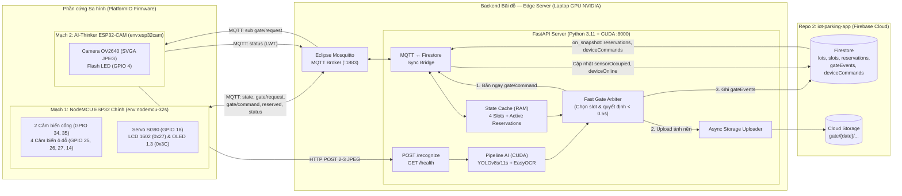
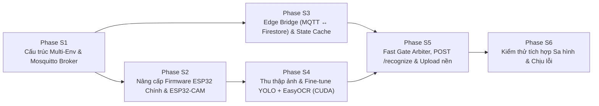

# KẾ HOẠCH PHÁT TRIỂN REPO 1: FIRMWARE IOT & BACKEND BÃI ĐỖ (`iot-parking-station`)
**Dự án:** Hệ thống Bãi đỗ xe Thông minh (Smart Parking System)  
**Tên Repository:** `iot-parking-station` *(triển khai trực tiếp trên repo `IOT-Parking` hiện tại)*  
**Phạm vi:**
1. **Firmware IoT (C++ / PlatformIO):** Mạch **NodeMCU ESP32 chính** (Cổng Barie, 4 cảm biến ô đỗ, LCD 1602, OLED 1.3", MQTT Client) + Mạch **ESP32-CAM** (Chụp biển số qua MQTT trigger & gửi HTTP POST).
2. **Backend Bãi đỗ — Edge Server (Python FastAPI + GPU NVIDIA CUDA + Mosquitto):** Quản lý MQTT Broker nội bộ, nhận diện biển số bằng **YOLOv8s/11s + EasyOCR**, ra quyết định đóng/mở barie tức thì (< 0.5s), và làm cầu nối đồng bộ hai chiều (MQTT ↔ Firestore / Cloud Storage).  

**Ngày cập nhật:** 2026-11-06  
**Repository đối tác trong hệ thống 2 Repo:**
- **Repo 1 (`iot-parking-station`)** — *Tài liệu này* (Toàn bộ Phần cứng, Firmware & Edge Server tại bãi đỗ)
- **Repo 2 (`iot-parking-app`)** — `Plan_Repo2_Android_And_Cloud_Backend.md` (Ứng dụng Android + Firebase Cloud Backend + Web Admin)

---

> [!IMPORTANT]
> **Ranh giới kiến trúc giữa Repo 1 và Repo 2 (Theo Phương án A đã chốt):**
> - **Repo 1 (`iot-parking-station`)** phụ trách toàn bộ những gì diễn ra **tại hiện trường bãi đỗ**: đọc cảm biến, điều khiển màn hình/barie, chụp ảnh, chạy AI nhận diện biển số trên GPU NVIDIA, kiểm tra bộ nhớ đệm (`state_cache`) để **mở/từ chối barie tức thì (< 0.5s)**, upload ảnh lên Storage và ghi sự kiện cổng vào bảng `gateEvents` kèm trạng thái cảm biến `sensorOccupied` lên Firestore.
> - **Repo 1 KHÔNG xử lý tài chính:** Không tính phí đỗ xe, không sửa `walletBalance`, không trực tiếp tạo/đóng `sessions` hay `transactions`, và không gửi FCM. Toàn bộ nghiệp vụ tiền, cọc, phiên đỗ và thông báo đẩy do **Repo 2 (`iot-parking-app`)** độc quyền xử lý ngay khi nhận được `gateEvents` từ Repo 1.

---

## 0. TIẾN ĐỘ TRIỂN KHAI HIỆN TẠI (CẬP NHẬT 2026-11-10)

| Giai đoạn | Hạng mục | Trạng thái | Chi tiết trong Codebase |
|:---:|:---|:---:|:---|
| **Phase F1** | Khung dự án & `include/config.h` | ✅ **Đã xong (100%)** | Đã định nghĩa đầy đủ Pinmap GPIO, địa chỉ I2C (`0x27`, `0x3C`), hằng số timing non-blocking. |
| **Phase F2** | Module `ParkingMonitor` (4 ô đỗ) | ✅ **Đã xong (100%)** | Đã có [`ParkingMonitor.h`](../include/ParkingMonitor.h) / [`.cpp`](../src/ParkingMonitor.cpp), đọc & debounce 250ms cho 4 cảm biến `A1, A2, B1, B2`. |
| **Phase F3** | Module `GateController` (Cổng & Barie cục bộ) | ✅ **Đã xong (100%)** | Đã có [`GateController.h`](../include/GateController.h) / [`.cpp`](../src/GateController.cpp), FSM phát hiện chiều vào/ra, điều khiển Servo SG90 & Safety Timeout 10s. |
| **Phase F4** | Module `DisplayManager` (LCD 1602 & OLED 1.3") | ✅ **Đã xong (100%)** | Đã có [`DisplayManager.h`](../include/DisplayManager.h) / [`.cpp`](../src/DisplayManager.cpp), chống nhấp nháy LCD, vẽ mũi tên điều hướng Khu A/B trên OLED SH1106. |
| **Phase F5** | Tích hợp vòng lặp chính `src/main.cpp` | ✅ **Đã xong (100%)** | Đã tích hợp chạy non-blocking trong [`main.cpp`](../src/main.cpp) và khung [`ParkingNetworkClient.cpp`](../src/ParkingNetworkClient.cpp) (đang ở chế độ HTTP cục bộ). |
| **Phase S1** | Cấu trúc Multi-Env (`gate` + `cam`) & Mosquitto Broker | ✅ **Đã xong (100%)** | Đã tách `src/gate/`, `src/cam/main_cam.cpp`, `include/common_network.h`, `include/cam_config.h`, `platformio.ini` multi-env và `edge-backend/mosquitto/`. |
| **Phase S2** | Nâng cấp ESP32 Chính (MQTT + Reserved + Auth 8s) & Code ESP32-CAM | ✅ **Đã xong (100%)** | Đã hoàn thiện `ParkingMonitor` (reservedMask), `GateController` (WAIT_AUTH + Offline Fallback 8s), `DisplayManager` (LCD/OLED), `ParkingNetworkClient` (MQTT PubSubClient + Ring Buffer) và `src/cam/main_cam.cpp`. |
| **Phase S3** | Edge Server: MQTT ↔ Firestore Bridge & State Cache | ✅ **Đã xong (100%)** | Đã hoàn thiện FastAPI, RAM [`StateCache`](../edge-backend/app/state_cache.py) RLock, [`MqttBridge`](../edge-backend/app/mqtt/bridge.py) paho-mqtt v2, [`FirestoreBridge`](../edge-backend/app/cloud/firestore_bridge.py) & [`NullCloudBridge`](../edge-backend/app/cloud/null_bridge.py), REST APIs `/health` & `/debug`, script mô phỏng [`simulate_gate.py`](../edge-backend/scripts/simulate_gate.py) và 22/22 unit tests. |
| **Phase S4** | Thu thập Dataset & Pipeline AI YOLO + EasyOCR (CUDA) | ✅ **Đã xong (100%)** | Đã cấu hình PyTorch CUDA 12.8 trên RTX 5060, tải model YOLOv8 VN [`plate_yolo_s.pt`](../edge-backend/models/plate_yolo_s.pt) (8.4ms), hoàn thiện [`detector.py`](../edge-backend/app/recognition/detector.py), [`ocr.py`](../edge-backend/app/recognition/ocr.py) (ghép 2 dòng), [`plate_utils.py`](../edge-backend/app/recognition/plate_utils.py), [`pipeline.py`](../edge-backend/app/recognition/pipeline.py), benchmark đạt latency **50.4ms** và 54/54 unit tests passed. |
| **Phase S5** | Fast Gate Arbiter (< 0.5s), `POST /recognize` & Upload Storage nền | ⏳ **Chưa làm (0%)** | Cần hiện thực `gate_arbiter.py`, endpoint nhận ảnh từ CAM và luồng ghi `gateEvents` + upload ảnh bất đồng bộ. |
| **Phase S6** | Kiểm thử tích hợp Sa hình & Chịu lỗi (`ST-01` → `ST-08`) | ⏳ **Chưa làm (0%)** | Thực hiện sau khi hoàn tất S1 → S5. |

---

## 1. KIẾN TRÚC TỔNG THỂ REPO 1 (FIRMWARE + EDGE SERVER)



---

## 2. CẤU TRÚC THƯ MỤC REPO 1 (`iot-parking-station/`)

Gộp Firmware và Edge Backend vào cùng một repository giúp đồng bộ tuyệt đối cấu hình MQTT Topic, cấu trúc gói tin JSON và công cụ thu thập ảnh huấn luyện AI:

```
iot-parking-station/
├── platformio.ini                   # Khai báo 2 môi trường: [env:nodemcu-32s] và [env:esp32cam]
├── include/                         # Header dùng cho Firmware C++
│   ├── common_network.h             # Wi-Fi, IP Edge Server, MQTT Topics & Credentials
│   ├── config.h                     # Pinmap GPIO & hằng số timing cho ESP32 chính
│   ├── cam_config.h                 # Pinmap OV2640 & cấu hình chụp cho ESP32-CAM
│   ├── ParkingMonitor.h             # Giám sát 4 cảm biến ô đỗ + mặt nạ reservedMask
│   ├── GateController.h             # FSM cổng + WAIT_AUTH + Fallback cục bộ 8s
│   ├── DisplayManager.h             # Render LCD 1602 & OLED 1.3" theo assignedSlot
│   └── ParkingNetworkClient.h       # MQTT Client non-blocking + hàng đợi sự kiện offline
├── src/
│   ├── gate/                        # Source code cho [env:nodemcu-32s] (ESP32 chính)
│   │   ├── main.cpp
│   │   ├── ParkingMonitor.cpp
│   │   ├── GateController.cpp
│   │   ├── DisplayManager.cpp
│   │   └── ParkingNetworkClient.cpp
│   └── cam/                         # Source code cho [env:esp32cam] (ESP32-CAM)
│       └── main_cam.cpp
└── edge-backend/                    # Toàn bộ Backend Bãi đỗ (Python + Mosquitto)
    ├── app/
    │   ├── main.py                  # FastAPI entry; lifespan: GPU warm-up, start MQTT & Firestore
    │   ├── config.py                # Pydantic Settings đọc từ .env
    │   ├── state_cache.py           # Cache RAM: 4 cảm biến vật lý + activeReservations + pending seq
    │   ├── api/
    │   │   ├── recognize.py         # POST /recognize (nhận multipart từ ESP32-CAM)
    │   │   └── health.py            # GET /health (trạng thái CUDA, MQTT, Firebase)
    │   ├── recognition/
    │   │   ├── detector.py          # YOLOv8s/11s CUDA inference + crop biển số (padding 8%)
    │   │   ├── ocr.py               # OpenCV tiền xử lý + EasyOCR (gpu=True) + ghép biển 2 dòng
    │   │   └── plate_utils.py       # Chuẩn hóa, sửa ký tự dễ nhầm theo vị trí + Regex VN
    │   ├── arbiter/
    │   │   └── gate_arbiter.py      # Chọn slot & quyết định OPEN/DENY tức thì + timeout 5s
    │   ├── mqtt/
    │   │   └── bridge.py            # paho-mqtt client: parse state/request/status, publish command/reserved
    │   └── cloud/
    │       ├── firestore_bridge.py  # Ghi gateEvents, sensorOccupied, deviceOnline; on_snapshot từ Repo 2
    │       └── storage_uploader.py  # ThreadPool upload ảnh gốc & ảnh crop lên Cloud Storage
    ├── mosquitto/
    │   ├── mosquitto.conf
    │   ├── passwd                   # Tài khoản: esp32_gate_01, esp32_cam_01, edge_server
    │   └── acl                      # Phân quyền topic chặt chẽ
    ├── models/
    │   └── plate_yolo_s.pt          # Trọng số YOLO đã fine-tune trên biển số sa hình
    ├── scripts/
    │   ├── capture_dataset.py       # Script thu ảnh từ ESP32-CAM để gán nhãn Roboflow
    │   └── benchmark_pipeline.py    # Đo accuracy & latency trên GPU NVIDIA
    ├── tests/
    │   ├── plate_test_cases.json    # Bản sao test vector biển số đồng bộ với Repo 2
    │   └── test_plate_utils.py
    ├── docker-compose.yml           # Chạy Mosquitto (+ Edge Server)
    ├── .env.example
    └── requirements.txt
```

---

## 3. PHẦN A — THIẾT KẾ CHI TIẾT FIRMWARE IOT (ESP32 & ESP32-CAM)

### 3.1. Nguyên tắc bất biến của Firmware (Hard Rules)
1. **Không dùng `delay()` trong `loop()` của ESP32 chính:** Mọi tác vụ quét cảm biến, điều khiển Servo, làm tươi LCD/OLED và reconnect Wi-Fi/MQTT đều quản lý bằng `millis()`.
2. **Chung bus I2C an toàn:** LCD (`0x27`) và OLED (`0x3C`) dùng chung `SDA = GPIO 21`, `SCL = GPIO 22`. Chỉ gửi dữ liệu vẽ lại khi nội dung thực sự thay đổi.
3. **Debounce cảm biến 250ms:** Áp dụng cho cả 4 cảm biến ô đỗ (`GPIO 25, 26, 27, 14`) và 2 cảm biến cổng (`GPIO 34, 35` — chỉ cấu hình `INPUT` thuần, Active LOW).
4. **Offline Fallback 8 giây:** Khi xe chạm cảm biến cổng mà mất kết nối tới Edge Server hoặc quá **8 giây** không nhận được `gate/command`, ESP32 chính tự động xử lý cục bộ (mở barie nếu còn chỗ) để không kẹt xe.
5. **Safety Timeout 10 giây:** Khi barie đã mở nhưng sau **10 giây** xe chưa đi qua hết, tự động hạ barie và đưa máy trạng thái về `IDLE`.

### 3.2. Thiết kế nâng cấp cho ESP32 Chính (`src/gate/`)
*(Trên nền tảng các module `ParkingMonitor`, `GateController`, `DisplayManager`, `ParkingNetworkClient` đã có sẵn)*

- **`ParkingMonitor` (Thêm mặt nạ đặt chỗ `reservedMask`):**
  - Nhận mảng trạng thái đặt trước `reservedMask[4]` từ topic MQTT `parking/ESP32_PARKING_01/reserved`.
  - Ô đỗ `i` chỉ được coi là trống cho khách vãng lai khi **`!isOccupied(i) && !isReserved(i)`**.
- **`GateController` (Máy trạng thái có xác thực MQTT & Fallback):**
  - Khi ở `IDLE`:
    - `S_OUT` chạm → tăng biến đếm `currentSeq++`, chuyển sang `GATE_STATE_WAIT_AUTH_IN`, phát sự kiện yêu cầu gửi MQTT `gate/request {"seq": currentSeq, "direction": "IN"}`.
    - `S_IN` chạm → tăng `currentSeq++`, chuyển sang `GATE_STATE_WAIT_AUTH_OUT`, phát `gate/request {"seq": currentSeq, "direction": "OUT"}`.
  - Khi ở `WAIT_AUTH_IN` / `WAIT_AUTH_OUT`:
    - Nhận `gate/command` có `seq == currentSeq`: nếu `action == "OPEN"` → mở barie, lưu `plate` và `assignedSlot` để hiển thị, chuyển sang `ENTERING_WAIT_IN` (hoặc `EXITING_WAIT_OUT`); nếu `action == "DENY"` → giữ đóng barie, chuyển sang `BLOCKED_FULL`.
    - Nếu `millis() - authStartTime >= 8000` (Fallback 8s): tự mở barie nếu bãi còn chỗ trống (hoặc nếu là chiều ra), ghi sự kiện vào hàng đợi RAM để báo bù khi có mạng lại.
  - Nhận `gate/command` đặc biệt có `seq == 0` và `action == "OPEN"` (Admin bấm mở khẩn cấp trên Web) → mở barie ngay lập tức.
- **`DisplayManager` (Hiển thị Biển số & Chỉ dẫn ô đỗ được gán):**
  - **LCD 1602:** Lúc chờ OCR hiện `DANG NHAN DIEN.. / VUI LONG CHO...`; lúc duyệt vào hiện `MOI VAO: O A2 / 51A-123.45`; lúc duyệt ra hiện `TAM BIET QUY KH / 51A-123.45`.
  - **OLED 1.3":** Khi xe vừa được duyệt vào kèm `assignedSlot` (vd `"A2"`), vùng trên vẽ mũi tên lớn rẽ **TRÁI** (Khu A) hoặc **PHẢI** (Khu B) kèm chữ **`-> A2`**. Dòng dưới hiển thị trạng thái 4 ô (`[X]` = có xe, `[R]` = đã đặt trước, `[ ]` = trống).

### 3.3. Thiết kế Firmware ESP32-CAM (`src/cam/main_cam.cpp`)
- Khởi tạo camera OV2640 ở chế độ **SVGA (`800x600`)**, `PIXFORMAT_JPEG`, `jpeg_quality = 12`, `fb_count = 2` (dùng PSRAM).
- Kết nối Wi-Fi và Mosquitto Broker với tài khoản `esp32_cam_01`, LWT `parking/ESP32_CAM_01/status = "offline"`, subscribe `parking/ESP32_PARKING_01/gate/request`.
- Khi nhận `gate/request {"seq": 42, "direction": "IN"}`:
  1. Bật đèn LED Flash (`GPIO 4` = HIGH) trước 150ms để cảm biến ảnh tự cân bằng sáng.
  2. Xả bỏ 1 frame cũ trong bộ đệm (`esp_camera_fb_get()` rồi `esp_camera_fb_return()`).
  3. Chụp liên tiếp **2 frame JPEG** cách nhau 150ms, tắt LED Flash.
  4. Mở kết nối TCP (`WiFiClient`) gửi `HTTP POST multipart/form-data` tới `http://<EDGE_IP>:8000/recognize` gồm header `X-API-Key`, các trường `device_id`, `seq`, `direction` và 2 file ảnh.

---

## 4. PHẦN B — THIẾT KẾ CHI TIẾT BACKEND BÃI ĐỖ (`edge-backend/`)

### 4.1. Giao thức MQTT Nội bộ (Giữa Firmware và Edge Server — Khớp Firmware Phase S2)

| Topic | Chiều | QoS | Retain | Cấu trúc Payload JSON (Thực tế từ Firmware S2) |
|:---|:---|:--:|:--:|:---|
| `parking/ESP32_PARKING_01/state` | ESP32 Chính → Edge | 1 | ✅ | `{"deviceId":"ESP32_PARKING_01","uptime":1205,"freeSlots":3,"totalSlots":4,"barrierOpen":false,"gateState":"IDLE","slots":{"A1":{"occupied":true,"reserved":false},"A2":{"occupied":false,"reserved":false},"B1":{"occupied":false,"reserved":false},"B2":{"occupied":false,"reserved":false}},"summary":{"zone_A_available":1,"zone_B_available":2,"total_available":3,"total_occupied":1,"total_reserved":0}}` |
| `parking/ESP32_PARKING_01/gate/request` | ESP32 Chính → CAM & Edge | 1 | ❌ | Thường: `{"deviceId":"ESP32_PARKING_01","seq":42,"direction":"IN","freeSlots":3,"timestamp":120500}`<br/>Đồng bộ bù Offline Fallback: `{"deviceId":"ESP32_PARKING_01","seq":42,"direction":"IN","offlineFallback":true,"clientTimestamp":120500}` |
| `parking/ESP32_PARKING_01/gate/command` | Edge → ESP32 Chính | 1 | ❌ | Cho vào: `{"seq":42,"action":"OPEN","plate":"51A12345","assignedSlot":"A2"}`<br/>Từ chối: `{"seq":42,"action":"DENY","plate":"51A12345","reason":"FULL"}`<br/>Mở khẩn cấp Admin: `{"seq":0,"action":"OPEN","plate":"ADMIN_OPEN","assignedSlot":""}` |
| `parking/ESP32_PARKING_01/reserved` | Edge → ESP32 Chính | 1 | ✅ | `{"A1":true,"A2":false,"B1":false,"B2":false}` |
| `parking/ESP32_PARKING_01/status` | ESP32 Chính → Edge (LWT) | 1 | ✅ | `"online"` / `"offline"` |
| `parking/ESP32_CAM_01/status` | ESP32-CAM → Edge (LWT) | 1 | ✅ | `"online"` / `"offline"` |

### 4.2. Pipeline AI Nhận diện Biển số trên GPU NVIDIA (< 0.5s)
1. **Phát hiện vùng biển số (`detector.py`):** Chạy model **YOLOv8s / YOLO11s** (PyTorch CUDA, `conf >= 0.5`) cắt vùng biển số kèm lề mở rộng (padding) 8%.
2. **Tiền xử lý & Đọc ký tự (`ocr.py`):** Chuyển ảnh xám, phóng đại `2x`, cân bằng tương phản cục bộ (`CLAHE`), lọc nhiễu `Bilateral Filter`, đưa vào `easyocr.Reader(['en'], gpu=True)` với `allowlist='0123456789ABCDEFGHIJKLMNOPQRSTUVWXYZ'`. Sắp xếp các box ký tự theo dòng `Y` rồi theo cột `X` để đọc chính xác cả biển 1 dòng và biển 2 dòng.
3. **Hậu xử lý & Voting đa khung (`plate_utils.py`):**
   - Chuẩn hóa: in hoa, bỏ khoảng trắng, `-`, `.`, `/`.
   - Sửa ký tự dễ nhầm theo vị trí biển số VN: Vị trí 1–2 (mã tỉnh, bắt buộc số: `O/D/Q→0`, `I/L→1`, `Z→2`, `S→5`, `G→6`, `B→8`); Vị trí 3 (seri chữ: `0→D`, `8→B`, `5→S`, `1→T`); 4–5 ký tự cuối (bắt buộc số).
   - Kiểm tra khớp Regex `^[0-9]{2}[A-Z][A-Z0-9]?[0-9]{4,5}$` và chọn kết quả có điểm tự tin cao nhất giữa các frame chụp.
4. **CUDA Warm-up:** Chạy thử 1 ảnh giả ngay trong `lifespan` khi bật FastAPI để nạp sẵn model vào VRAM.

### 4.3. Thuật toán Quyết định Cổng Tức thì (`gate_arbiter.py`)
Dựa trên `state_cache` trong RAM (gồm trạng thái vật lý `sensorOccupied` của 4 ô và danh sách `activeReservations` đồng bộ realtime từ Repo 2):
- **Khi xe vào (`direction == "IN"`):**
  1. Nếu biển số khớp với một `reservation` đang `active` (`plate == res.plate`):
     - Ô đã đặt đang trống (`!sensorOccupied`) → `OPEN`, `assignedSlot = res.slotId`, `matchedReservationId = res.id`.
     - Ô đã đặt bị xe khác đỗ đè → tìm ô trống khác chưa bị đặt (`A1 → A2 → B1 → B2`), gắn cờ `reserved_slot_substituted`. Nếu cả bãi đã hết chỗ → `DENY` (`reason = "RESERVED_SLOT_TAKEN"` để Repo 2 tự động hoàn cọc).
  2. Nếu biển số không có đặt chỗ (hoặc khác biển số đã đặt, hoặc không đọc được biển `unrecognized`):
     - Tìm ô đầu tiên có **`!sensorOccupied && !isReservedByAnyone`** theo thứ tự `A1 → A2 → B1 → B2`.
     - Có ô trống → `OPEN` kèm `assignedSlot`. Hết ô trống → `DENY` (`reason = "FULL"`).
- **Khi xe ra (`direction == "OUT"`):** Luôn trả `OPEN`.
- **Timeout chờ ảnh 5 giây:** Nếu sau 5s kể từ bản tin MQTT `gate/request` mà chưa nhận được HTTP POST từ ESP32-CAM, tự động chạy `gate_arbiter` với trạng thái `unrecognized` để mở cổng (nếu còn chỗ).

### 4.4. Hợp đồng Đồng bộ giữa Repo 1 (`edge-backend`) và Repo 2 (Firebase Cloud)
- **Từ Repo 1 ghi lên Firestore/Storage của Repo 2:**
  1. Sau khi phát MQTT `gate/command` (hoặc khi nhận sự kiện `offlineFallback`), ghi ngay bản ghi vào `gateEvents/{eventId}`:
     `{ deviceId, lotId: "lot_live_01", seq, direction, plateRaw, plateNormalized, confidence, decision, denyReason?, assignedSlotId?, matchedReservationId?, flags, status: "ok"|"unrecognized"|"offline_fallback", imageUrl, cropImageUrl, latencyMs, serverTs }` → kích hoạt Cloud Function `onGateEventCreated` ở Repo 2.
  2. Khi nhận MQTT `state` từ ESP32: cập nhật `lots/lot_live_01/slots/{slotId}` với `{ sensorOccupied, updatedAt: serverTs }` *(Trigger `onSlotUpdate.ts` của Repo 2 tự suy diễn `status` và `lots/lot_live_01.availableSlots`)*.
  3. Khi nhận MQTT `status` (LWT): cập nhật `devices/{id}` với `{ online, lastSeen: serverTs, lotId: "lot_live_01", type }` và `lots/lot_live_01` với `{ deviceOnline, camOnline, edgeHeartbeatAt }`.
  4. Upload bất đồng bộ ảnh gốc & ảnh crop lên Cloud Storage (`gate/{yyyy-mm-dd}/...`).
- **Từ Repo 2 đẩy xuống Repo 1 (qua Firestore `on_snapshot`):**
  1. Lắng nghe `reservations` (`lotId == "lot_live_01"`, `status == "active"`) → cập nhật `state_cache` và publish retained `parking/ESP32_PARKING_01/reserved`.
  2. Lắng nghe `deviceCommands` (`deviceId == "ESP32_PARKING_01"`, `status == "pending"`) → publish `gate/command` (`seq = 0, action = "OPEN"`) và cập nhật `status = "sent"` (hoặc `status = "failed"`, `failReason = "EXPIRED"` nếu quá hạn 60s).

---

## 5. LỘ TRÌNH TRIỂN KHAI REPO 1 (PHASES S1 → S6)



### PHASE S1 — CẤU TRÚC PLATFORMIO MULTI-ENV & MOSQUITTO BROKER
- [ ] Tách thư mục `src/gate/` và `src/cam/` trong `platformio.ini`; tạo `include/common_network.h`.
- [ ] Khởi tạo thư mục `edge-backend/`, cấu hình `mosquitto/mosquitto.conf`, `passwd`, `acl` và `docker-compose.yml`.

**Đầu ra:** Biên dịch được cả 2 môi trường Firmware; Mosquitto Broker chạy ở cổng `1883` có xác thực mật khẩu và ACL.

### PHASE S2 — NÂNG CẤP FIRMWARE ESP32 CHÍNH & VIẾT FIRMWARE ESP32-CAM
- [ ] Nâng cấp ESP32 chính: `reservedMask` trong `ParkingMonitor`, `WAIT_AUTH` + Fallback 8s trong `GateController`, hiển thị biển số & ô đỗ trên LCD/OLED, và `PubSubClient` non-blocking trong `ParkingNetworkClient`.
- [ ] Viết `src/cam/main_cam.cpp` cho ESP32-CAM: nhận MQTT `gate/request`, bật flash, chụp 2 frame SVGA, gửi HTTP POST multipart.

**Đầu ra:** Dùng lệnh `mosquitto_pub` điều khiển được barie, LCD, OLED; che cảm biến cổng kích hoạt được ESP32-CAM chụp và gửi ảnh về laptop.

### PHASE S3 — EDGE SERVER: MQTT BRIDGE & ĐỒNG BỘ FIRESTORE
- [ ] Dựng khung FastAPI (`main.py`, `config.py`, `state_cache.py`, `/health`).
- [ ] Hiện thực `mqtt/bridge.py` và `cloud/firestore_bridge.py`: đồng bộ 2 chiều trạng thái cảm biến 4 ô, trạng thái `online/offline` (LWT), mặt nạ `reserved` và lệnh `deviceCommands`.

**Đầu ra:** Che cảm biến ô đỗ trên sa hình → Firestore cập nhật trong < 1s; tạo/huỷ reservation trên Firestore → OLED/LCD trên sa hình trừ/cộng chỗ trống ngay lập tức.

### PHASE S4 — DATASET SA HÌNH & PIPELINE AI YOLO + EASYOCR (CUDA)
- [ ] Chạy `scripts/capture_dataset.py` chụp 200–300 ảnh biển số xe mô hình qua ESP32-CAM, gán nhãn và fine-tune YOLOv8s/11s (`models/plate_yolo_s.pt`).
- [ ] Hiện thực `detector.py`, `ocr.py`, `plate_utils.py` + GPU Warm-up + pass 100% unit test với `plate_test_cases.json`.

**Đầu ra:** Độ chính xác đọc biển số sa hình đạt **≥ 90%**, thời gian xử lý AI trên GPU NVIDIA **< 0.4s/lượt**.

### PHASE S5 — FAST GATE ARBITER, API `/recognize` & UPLOAD STORAGE NỀN
- [ ] Hiện thực `gate_arbiter.py` (chọn slot ưu tiên reservation → Khu A → Khu B, chặn trùng `seq`, timer chờ ảnh 5s).
- [ ] Hiện thực `POST /recognize`: chạy AI → gọi `gate_arbiter` → bắn MQTT `gate/command` ngay lập tức → chạy background task ghi `gateEvents` và upload ảnh lên Cloud Storage.

**Đầu ra:** Xe mô hình chạm cảm biến cổng → chụp ảnh → nhận diện → barie mở kèm chỉ dẫn OLED trong **< 2.0 giây**; bản ghi `gateEvents` kèm ảnh xuất hiện đầy đủ trên Firestore.

### PHASE S6 — BỘ TEST CASE KIỂM THỬ REPO 1 (`iot-parking-station`)

| Mã TC | Hạng mục | Kịch bản kiểm thử | Kết quả mong đợi |
|:---:|:---|:---|:---|
| **ST-01** | Luồng vào chuẩn | Đưa xe biển `51A-123.45` chạm `S_OUT` khi bãi trống | CAM nháy flash chụp, Edge đọc đúng `51A12345`, gán `A1`, barie mở < 2s, LCD hiện `MOI VAO: O A1 / 51A12345`, OLED chỉ trái `-> A1` |
| **ST-02** | Ưu tiên Đặt chỗ | Ô `B1` đang `reserved` cho `51A12345`; đưa xe `51A-123.45` vào cổng | Edge gán đúng `B1` (dù `A1, A2` đang trống), OLED chỉ phải `-> B1`, ghi `gateEvent` kèm `matchedReservationId` |
| **ST-03** | Bảo vệ ô đã đặt | Bãi chỉ còn trống duy nhất `A1` nhưng đang `reserved` cho xe X; đưa xe Y tới cổng | Edge trả `DENY` (`reason: FULL`), barie giữ đóng, LCD báo `BAI DA DAY!` |
| **ST-04** | Hỏng / Tắt CAM | Rút nguồn ESP32-CAM rồi đưa xe chạm `S_OUT` (bãi còn chỗ) | Sau đúng 5.0s timeout, Edge Server tự phát `OPEN`, tạo `gateEvent` cờ `unrecognized` để không kẹt cổng |
| **ST-05** | Tắt Edge Server | Tắt hẳn FastAPI/Mosquitto trên laptop rồi đưa xe chạm `S_OUT` | Sau đúng 8.0s timeout trên ESP32, mạch tự fallback mở barie cục bộ (nếu còn chỗ) và lưu sự kiện vào RAM |
| **ST-06** | Khôi phục sau Reset | Đang có `A1` `reserved`, nhấn nút Reset cứng trên ESP32 chính | Vừa kết nối lại Mosquitto, ESP32 nhận ngay gói retained `reserved`, trừ đúng số chỗ trống trên LCD/OLED |
| **ST-07** | Mở cổng từ Admin | Tạo document `deviceCommands` (`action: OPEN_GATE`) trên Firestore | Edge Server nhận snapshot và phát MQTT mở barie trong < 1s, cập nhật `status = sent` |
| **ST-08** | Hiệu năng & Non-blocking | Gửi 20 lượt nhận diện liên tiếp; đo chu kỳ `loop()` trên ESP32 | GPU xử lý trung bình < 400ms/lượt; vòng lặp `loop()` của ESP32 luôn < 10ms, không nhấp nháy màn hình |

